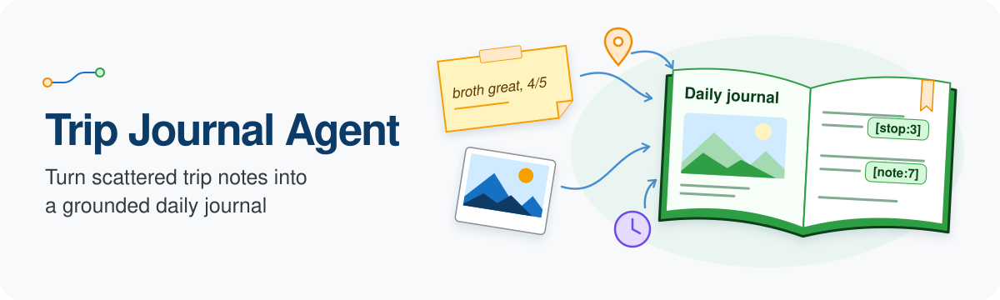
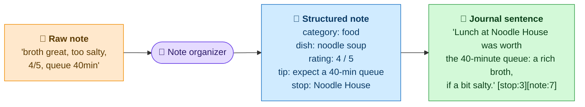
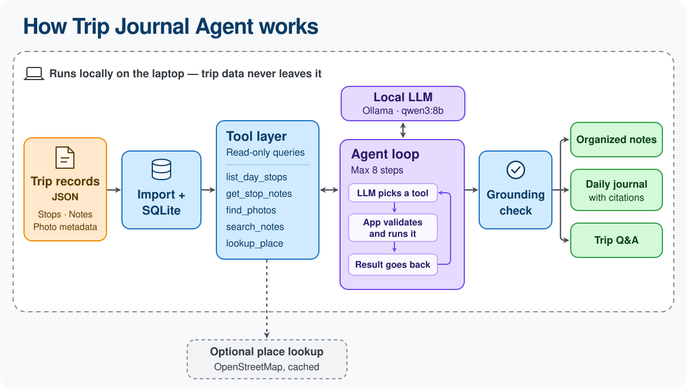
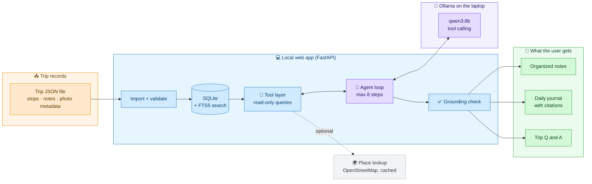
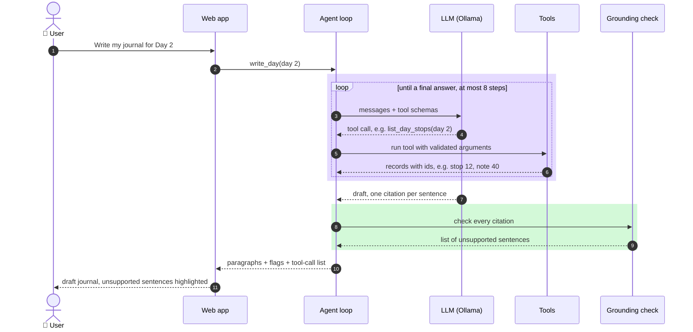
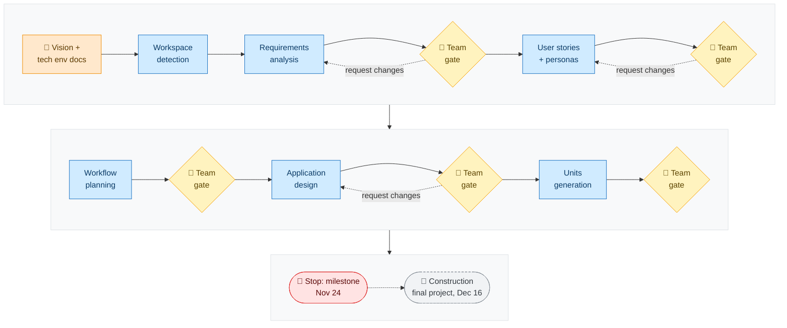
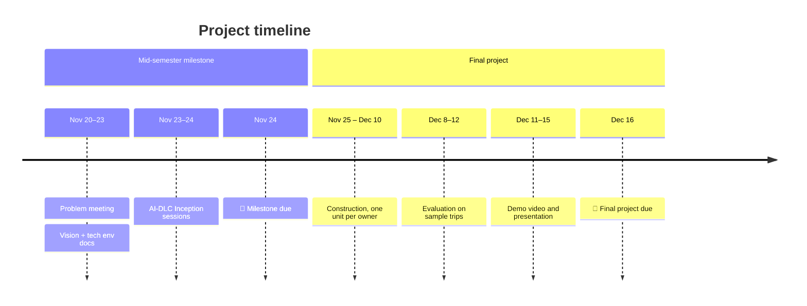

# Trip Journal Agent

INFO 5940, Fall 2026 — Class Project (Mid-semester Milestone: AI-DLC Inception phase)

## Team

| Full name | NetID | Role in Inception sessions |
|---|---|---|
| Ivan Huang | qh229 | Runs the coding agent and commits |
| Edwin Chen | ec769 | Product lead: leads the product answers (requirements, user stories, personas) and reviews every artifact |
| Zarif Karim | zk67 | Technical lead: leads the technical answers (Application Design, testing, units of work) and reviews every artifact |

## Tools

- **Coding agent:** Claude Code (the only coding agent the team uses)
- **Methodology:** AI-DLC **v1.0.1** (rules from `ai-dlc-rules-v1.0.1.zip`, installed as `CLAUDE.md` + `.aidlc-rule-details/`)
- **Planned LLM in the product:** a local open model served by **Ollama** (planned: `qwen3:8b`, a tool-calling model), called through Ollama's OpenAI-compatible API
- **Input documents:** [`docs/vision.md`](docs/vision.md), [`docs/technical-environment.md`](docs/technical-environment.md)
- **AI-DLC artifacts:** `aidlc-docs/` (generated by the workflow; not edited by hand)

## Problem and why an LLM fits

Travelers record far more than they ever look at again. A single day of a trip leaves a GPS track, a dozen stops, hundreds of photos, and a scattered set of quick text or voice notes typed in the moment ("noodles too salty, broth great, 4/5", "wait was 40 min, skip next time"). Turning that into something worth keeping — a readable day journal, or a quick answer to "where was that dumpling place on day 2?" — takes an evening of manual sorting that most people never do. One of our team members has built a personal trip-logging app and has lived this problem: the structured data is all there, but the story and the retrieval are not.

The hard part is not storing the data; it is interpreting it. Notes are short, informal, mixed-language and full of implicit references ("this place", "the second one"). Deciding what mattered in a day, writing it in a natural voice, and answering loose questions ("what did we eat that we liked?") needs language understanding and judgment that fixed rules and templates do badly. A template can list "Stop 3: 12:10–12:55", but it cannot tell that the user loved the broth and hated the wait, or that two notes describe the same meal. An LLM is good at exactly this: reading messy human text, linking it to structured facts, and writing or answering in plain language.

**Example — one note, from fragment to journal:**

## Planned LLM integration

The product is an **agent over the user's own trip data**. The LLM does not get the whole trip pasted into a prompt; it decides which tools to call — list a day's stops, read the notes for a stop, find photos taken in a time window, search notes by keyword, look up a place name for a coordinate — and uses the results before it writes. Three features depend on it: (1) a **note organizer** that classifies each raw note (food, scene, logistics, feedback), extracts dishes, ratings and tips, and attaches it to the right stop, with the user confirming; (2) a **daily journal agent** that plans the day's story, gathers facts through tools and writes a draft journal in which every sentence cites the stop or note it came from; and (3) a **trip Q&A agent** that answers questions about the trip by querying the data, and says "I don't know" when the data has no answer.

Grounding is a design goal, not an afterthought: a checker verifies that each journal sentence and each answer is backed by cited records, unsupported claims are flagged in the UI, and regenerating a journal never overwrites text the user wrote. We plan to run a local model through Ollama (`qwen3:8b` first, chosen for tool-calling support and laptop-sized memory) so personal location data never leaves the laptop. The model is called through the OpenAI-compatible endpoint, so switching to a larger local model or a hosted provider later is a configuration change.

**How the pieces fit together:**

The same flow as a diagram you can edit:

**What happens when the user asks for a day journal** (the LLM chooses the tools; the app validates and runs them):

## Scope and feasibility

By December 16 the finished product will be a local web app that: imports a trip from a JSON file (stops, track summary, notes, photo metadata), shows a day timeline, organizes notes with the LLM, generates and lets the user edit a grounded daily journal, and answers questions about the trip in a chat panel, with tool calls visible so the user can see how an answer was found. We will demo it on a synthetic sample trip that contains no real personal data. That is four user-facing features plus an agent loop, a tool layer and a grounding checker — a meaningful project, not a single feature — while each part is buildable by a small team in four weeks with Python, SQLite and a local model.

Deliberately out of scope (detailed in the vision document): a mobile app, live GPS tracking and stop detection (the import already contains stops), speech-to-text (notes arrive as text), photo content understanding with a vision model, recap videos, trip recommendations, accounts and cloud hosting. These keep the MVP focused on the part where the LLM adds the most value.

## Collaboration plan

- **Meetings:** twice a week, on Tuesday and Thursday right after the INFO 5940 class, about 60–90 minutes each; at least one full meeting dedicated to the problem and product idea before running AI-DLC.
- **Format:** hybrid: in person when everyone can attend, otherwise online on Zoom. AI-DLC sessions are run live on one laptop with the screen shared; the whole team reads each question file and agrees on every answer and approval together.
- **Between meetings:** a text-message group chat for quick questions; GitHub Issues for tasks and decisions; the repository is the single source of truth for documents.
- **Sharing the work:** Inception — one member drives the agent and commits, everyone answers questions and reviews each artifact; technical members lead the Application Design answers. Construction — each member owns one or more units of work from `aidlc-docs/inception/application-design/unit-of-work.md`, works on a branch, and opens a pull request that another member reviews.

**How we run AI-DLC together** (every stage ends at a team gate: we review the artifact together, then approve or request changes):

**Timeline:**

## Repository layout

| Path | Contents |
|---|---|
| `CLAUDE.md` | AI-DLC v1.0.1 core workflow (copy of `core-workflow.md`) |
| `.aidlc-rule-details/` | AI-DLC v1.0.1 rule details |
| `docs/vision.md` | Vision document (AI-DLC input) |
| `docs/technical-environment.md` | Technical environment document (AI-DLC input) |
| `aidlc-docs/` | Artifacts generated by AI-DLC, including `audit.md` and `aidlc-state.md` |
| *(repository root)* | Application code, added during Construction |
