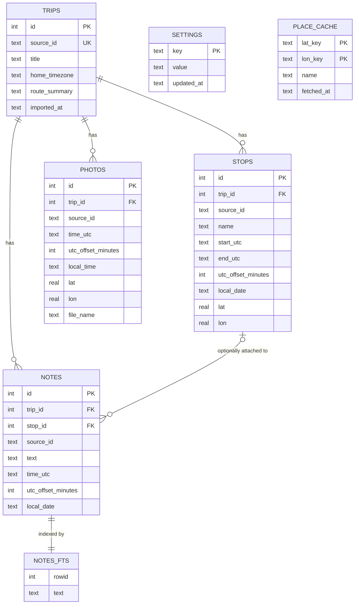

# U1 Foundation - Domain Entities

**Stage**: Construction - Functional Design (plan step B1)
**Source**: `aidlc-docs/construction/plans/u1-foundation-functional-design-plan.md` (Q1-Q26, all A), `component-methods.md`, `components.md`, `requirements.md`
**Scope**: the core tables U1 creates, the tool result views, the agent models, settings / status / job models and the user-facing error types. Tables owned by U3 (suggestions) and U4 (journals, paragraphs) are added by those units; the rules they must follow are in section 1.4.

Conventions (from `component-methods.md`): `*_id: int` is a SQLite row id; `source_id: str` is the id from the import file; times are stored as UTC ISO-8601 strings plus `utc_offset_minutes`; coordinates are WGS-84 decimal degrees. "Local time" means `time_utc + utc_offset_minutes`, written as a naive ISO-8601 string (`2026-05-03T12:30:00`).

---

## 1. Storage entities (SQLite, `data/schema.sql`)

### 1.1 Entity relationship diagram

Text alternative: a trip has many stops, notes and photos. A note may be attached to one stop of the same trip. Every note has one row in the FTS5 index. `SETTINGS` and `PLACE_CACHE` are global tables with no link to a trip.

### 1.2 Tables

| Table | Column | Type | Rules |
|---|---|---|---|
| `trips` | `id` | INTEGER PK | Row id, used in URLs and as the tool context's `trip_id` |
| | `source_id` | TEXT NOT NULL UNIQUE | `trip.trip_id` from the import file; a duplicate import is rejected (FR-1.6, U2) |
| | `title` | TEXT NOT NULL | |
| | `home_timezone` | TEXT NULL | Informational only |
| | `route_summary` | TEXT NULL | Optional, from the import |
| | `imported_at` | TEXT NOT NULL | UTC ISO-8601 |
| `stops` | `id` | INTEGER PK | Cited as `[stop:N]` |
| | `trip_id` | INTEGER NOT NULL FK → `trips.id` ON DELETE CASCADE | |
| | `source_id` | TEXT NOT NULL | UNIQUE (`trip_id`, `source_id`) |
| | `name` | TEXT NULL | Imported place name; may be missing (then `lookup_place` may help, US-17) |
| | `start_utc`, `end_utc` | TEXT NOT NULL | `end_utc >= start_utc` (checked by U2 import validation) |
| | `utc_offset_minutes` | INTEGER NOT NULL | |
| | `local_date` | TEXT NOT NULL | Local date of `start_utc`, derived at import by C18 (FR-2.1); index (`trip_id`, `local_date`, `start_utc`) |
| | `lat`, `lon` | REAL NOT NULL | |
| `notes` | `id` | INTEGER PK | Cited as `[note:N]` |
| | `trip_id` | INTEGER NOT NULL FK → `trips.id` ON DELETE CASCADE | |
| | `stop_id` | INTEGER NULL FK → `stops.id` ON DELETE CASCADE | Must belong to the same trip (checked at import) |
| | `source_id` | TEXT NOT NULL | UNIQUE (`trip_id`, `source_id`) |
| | `text` | TEXT NOT NULL | Raw note text; never changed after import (FR-3.4) |
| | `time_utc`, `utc_offset_minutes` | TEXT, INTEGER NOT NULL | |
| | `local_date` | TEXT NOT NULL | Derived at import; index (`trip_id`, `local_date`) |
| `photos` | `id` | INTEGER PK | Cited as `[photo:N]` |
| | `trip_id` | INTEGER NOT NULL FK → `trips.id` ON DELETE CASCADE | |
| | `source_id` | TEXT NOT NULL | UNIQUE (`trip_id`, `source_id`) |
| | `time_utc`, `utc_offset_minutes` | TEXT, INTEGER NOT NULL | |
| | `local_time` | TEXT NOT NULL | Naive local ISO-8601, derived at import; index (`trip_id`, `local_time`) for `find_photos` (Q10) |
| | `lat`, `lon` | REAL NULL | |
| | `file_name` | TEXT NULL | Metadata only (FR-2.3) |
| `notes_fts` | (virtual) | FTS5, `content='notes'`, `content_rowid='id'`, `tokenize='trigram'` | One indexed column `text` (Q8 A). Kept in sync with `notes` by insert / update / delete triggers |
| `settings` | `key` | TEXT PK | Keys: `model_name`, `ollama_base_url`, `place_lookup_enabled`; U2 adds `active_trip_id` (US-02 uses U1 settings storage) |
| | `value` | TEXT NOT NULL | Stored as text; booleans as `"true"` / `"false"` |
| | `updated_at` | TEXT NOT NULL | UTC ISO-8601 |
| `place_cache` | `lat_key`, `lon_key` | TEXT, composite PK | Coordinates rounded to 4 decimals, as text (Q22 A, rule PL-3) |
| | `name` | TEXT NOT NULL | Only successful lookups are cached (rule PL-6) |
| | `fetched_at` | TEXT NOT NULL | UTC ISO-8601 |

Derived columns (`local_date`, `local_time`) are written by U2's ImportService with C18 Day Derivation. U1 only defines the columns and reads them.

### 1.3 Connection and cascade rules
- Every connection runs `PRAGMA foreign_keys = ON` (C21 `connect`).
- Deleting a trip deletes its stops, notes and photos by cascade. The `notes` delete trigger removes the matching `notes_fts` rows, so a deleted trip leaves no searchable text (tested in Code Generation).
- `place_cache` and `settings` are not linked to trips and survive a trip deletion. The cache holds only rounded coordinates and a public place name.

### 1.4 Rules for tables added by other units
- U3 and U4 tables reference `trips.id` with `ON DELETE CASCADE` (Flow 2 in `services.md`).
- They are added in their own marked section of `schema.sql`; the U1 section is not edited.

---

## 2. Tool result views (`agent/tools.py`)

The tools return these views, never table rows. Every record carries its row id **and** a ready-made citation string `cite`, so the model can copy the exact citation format (the spike showed `llama3.1:8b` writing `[photo:1, photo:2]`).

| View | Fields | Notes |
|---|---|---|
| `StopView` | `stop_id: int`, `cite: str` (`"[stop:12]"`), `name: str \| None`, `start_local: str`, `end_local: str`, `lat: float`, `lon: float`, `note_count: int`, `photo_count: int` | `name` is the imported name |
| `NoteView` | `note_id: int`, `cite: str`, `stop_id: int \| None`, `time_local: str`, `text: str`, `truncated: bool` | `text` cut at 1,000 characters plus `…(truncated)` (Q7 A). U3 may add organized fields |
| `PhotoView` | `photo_id: int`, `cite: str`, `time_local: str`, `lat: float \| None`, `lon: float \| None`, `file_name: str \| None` | |
| `NoteHit` | `note_id: int`, `cite: str`, `stop_id: int \| None`, `time_local: str`, `text: str`, `truncated: bool` | Same shape as `NoteView`, ordered by relevance |
| `PlaceName` | `name: str \| None`, `source: Literal["import", "cache", "nominatim", "none"]`, `stop_id: int \| None` | `stop_id` is the stop whose coordinates match (rule PL-2); **new field** (section 6) |

A list result is wrapped as `{"tool": <name>, "records": [...], "truncated": bool, "total": int}`. `truncated` is true when the 50-record cap removed records; `total` is the number before the cap.

---

## 3. Agent models

| Model | Fields | Notes |
|---|---|---|
| `ToolCall` | `id: str`, `name: str`, `arguments_json: str` | From the model; untrusted. A missing `id` is replaced by `call_<step>_<index>` |
| `LLMReply` | `content: str \| None`, `tool_calls: list[ToolCall]` | `content` has `<think>…</think>` blocks removed (rule AL-9) |
| `ToolOutcome` | `content: str`, `returned_ids: list[Citation]`, `error: ToolError \| None` | `content` is the delimited text sent back to the model (rule TR-1). **Defined here** (named but not defined in `component-methods.md`) |
| `ToolError` | `kind: Literal["unknown_tool", "invalid_arguments", "tool_failed", "not_run"]`, `message: str` | |
| `ToolCallRecord` | `step: int`, `name: str`, `arguments: dict[str, Any]`, `returned_ids: list[Citation]`, `error: str \| None` | One per tool call; stores ids, not returned data (Q25 A). Unparseable arguments are kept as `{"_raw": <first 200 characters>}` |
| `AgentResult` | `final_text: str \| None`, `trace: list[ToolCallRecord]`, `stopped_reason: Literal["final_answer", "step_limit"]` | Unchanged |
| `Citation` | `kind: Literal["stop", "note", "photo"]`, `record_id: int` | From C19 |
| `SentenceCheck` | `sentence: str`, `citations: list[Citation]`, `supported: bool` | From C19 |

---

## 4. Settings, status and jobs

| Model | Fields | Notes |
|---|---|---|
| `Settings` | `model_name: str = "qwen3:8b"`, `ollama_base_url: str = "http://localhost:11434/v1"`, `place_lookup_enabled: bool = False` | Defaults from US-18 Scenario 2. The default model may change in NFR Requirements (spike results); this design only fixes where the default lives (`config.py`) |
| `SettingsUpdate` | `model_name: str \| None`, `ollama_base_url: str \| None`, `place_lookup_enabled: bool \| None` | `None` = leave unchanged. **Defined here** |
| `ModelStatus` | `reachable: bool`, `model_installed: bool`, `model_name: str`, `base_url: str` | Unchanged; `ok` = both true. The message comes from rule ST-5 |
| `JobStatus` | `job_id`, `kind`, `state`, `step`, `result`, `error`, **`trace: list[ToolCallRecord]`**, **`started_at: str`**, **`finished_at: str \| None`** | `trace` is filled while the job runs, so a failed or timed-out job can show the trace so far (Q20, Q26). **Changed** (section 6) |
| `JobProgress` | `step(message: str) -> None` (also callable as `ProgressCallback`), `tool_call(record: ToolCallRecord) -> None` | Given to the job's work function. **New** (section 6) |

Job states: `running` → `done` or `failed`. There is no other state and no way back.

---

## 5. User-facing errors (`services/errors.py`)

Every error a user can see becomes a `UserFacingError`: `code: str`, `message: str` (what went wrong), `action: str` (what to do next, NFR-5.2), `trace: list[ToolCallRecord]` (empty when there is none). The exact wording per code is in `business-rules.md`, rule ER-1.

| Exception | Code(s) | Raised by | HTTP (API) |
|---|---|---|---|
| `ModelUnavailableError(status)` | `ollama_unreachable`, `model_missing` | services before a job, from `model_status()` | 503 |
| `ModelBusyError` | `model_busy` | `JobRunner.start` | 429 |
| `AgentStepLimitError(trace)` | `step_limit` | services when `stopped_reason == "step_limit"` | job `failed` |
| **`ModelCallError(reason, trace)`** | `model_timeout`, `model_error` | `AgentLoop` when `LLMClient.chat` times out or fails (Q26 A). **New** | job `failed` |
| **`JobTimeoutError`** | `job_timeout` | `JobRunner` after 5 minutes (Q20 A). **New** | job `failed` |
| **`SettingsValidationError(issues)`** | `invalid_settings` | `SettingsService.update` (Q15 A). **New** | 422 |
| `NotFoundError` | `job_not_found` (and others in U2-U5) | `JobRunner.status` for a removed or unknown job (Q19 A) | 404 |
| (any other exception inside a job) | `internal_error` | `JobRunner` | job `failed` |

Errors inside tools are **not** exceptions for the user: they become error results for the model (rule AL-5) and appear in the trace.

---

## 6. Interface changes compared with `component-methods.md`

| # | Component | Change | Reason |
|---|---|---|---|
| IC-1 | C09 `JobStatus` | Add `trace`, `started_at`, `finished_at` | Show the trace so far on failure and timeout (Q20, Q26, US-20 Scenario 1) |
| IC-2 | C09 `JobRunner.start` | `work: Callable[[JobProgress], Awaitable[BaseModel]]` instead of `Callable[[ProgressCallback], ...]`. `JobProgress` is still callable with a string, so code written for `ProgressCallback` keeps working | Same as IC-1 |
| IC-3 | C09 `JobRunner.__init__` | `JobRunner(max_finished: int = 20, timeout_s: float = 300)` | Q19 A, Q20 A |
| IC-4 | C11 `AgentLoop.run` | Add `on_tool_call: Callable[[ToolCallRecord], None] \| None = None` | Feeds `JobProgress.tool_call` (IC-1) |
| IC-5 | C11 `AgentLoop.run` | Raises `ModelCallError(reason, trace)` when a model call times out or fails | Q26 A; `stopped_reason` stays `final_answer` / `step_limit` |
| IC-6 | C12 | Define `ToolOutcome` and `ToolError` (named but undefined before) | Rule TR-1 |
| IC-7 | C12 views | Every view gets `cite: str`; list results get `truncated` and `total` | Spike citation failure; Q7 A |
| IC-8 | C23 `PlaceName` | Add `stop_id: int \| None` | Q24 A: the tool finds the stop by coordinates (rule PL-2) |
| IC-9 | C22 `StopRepository` | Add `find_by_coordinates(trip_id, lat_key, lon_key) -> StopRow \| None` | Rule PL-2 |
| IC-10 | C22 `NoteRepository.search` | Two paths: FTS5 trigram, or `LIKE` when any term is shorter than 3 characters | Q8 A, Q9 A |
| IC-11 | C08 | Define `SettingsUpdate`; add `SettingsValidationError`; `update` returns `Settings` and the caller then reads `model_status()` for the warning | Q15 A, Q16 A |
| IC-12 | Errors | Add `ModelCallError`, `JobTimeoutError`, `SettingsValidationError`, and the `UserFacingError` fields `code`, `action`, `trace` | Q20, Q26, Q15; NFR-5.2 |
| IC-13 | C10 | Add the pure function `status_message(status: ModelStatus) -> UserFacingError \| None` (in `services/errors.py`) | One wording for the banner, the Settings warning and `ModelUnavailableError` (Q16-Q18) |

No signature in `component-methods.md` is removed. U3-U5 owners should read IC-1, IC-2, IC-4 and IC-5, because their services call `JobRunner.start` and `AgentLoop.run`.
