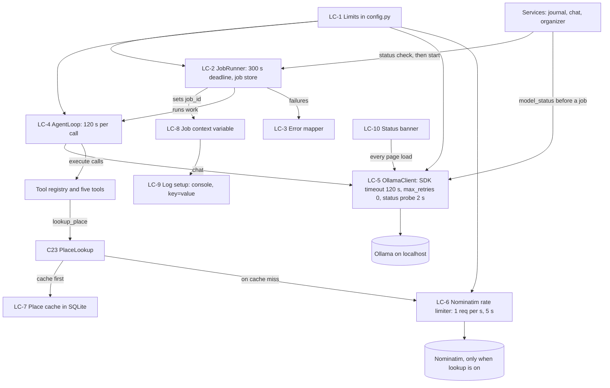

# U1 Foundation - Logical Components

**Stage**: Construction - NFR Design (plan step 5)
**Source**: `nfr-design-patterns.md` (patterns NP-1 to NP-9), `unit-of-work.md` (U1 modules), `component-methods.md`, plan answers Q1-Q6 (all A, owner, 2026-11-26)
**Scope**: the logical parts that carry out U1's NFRs, where each lives, and how they connect. They sit inside the components already named in Application Design (C08-C12, C21-C23); only `trip_journal/logs.py`, `tests/conftest.py` and `tests/strategies.py` are new files.

---

## 1. Components

| Id | Logical component | Lives in | Inside component | Pattern | What it does |
|---|---|---|---|---|---|
| LC-1 | Limits | `config.py` | shared | NP-1, NP-4 | Constants `JOB_TIMEOUT_S=300`, `MODEL_CALL_TIMEOUT_S=120`, `STATUS_TIMEOUT_S=2`, `NOMINATIM_TIMEOUT_S=5`, `NOMINATIM_MIN_INTERVAL_S=1.0`. Not settings; passed to constructors |
| LC-2 | Job deadline and job store | `services/jobs.py` | C09 JobRunner | NP-1, NP-2 | One `asyncio` task per job inside `asyncio.timeout(timeout_s)`; in-memory store (insertion-ordered dict) of at most 1 running and 20 finished jobs (JB-1, JB-5); sets LC-8 at task start; maps `TimeoutError` to `job_timeout` |
| LC-3 | Error mapper | `services/errors.py` | C05 shared errors | NP-2 | The one place that turns exceptions into `UserFacingError` (ER-1 to ER-3); logs `internal_error` with the exception |
| LC-4 | Model-call deadline | `agent/loop.py` | C11 AgentLoop | NP-1 | `asyncio.timeout(call_timeout_s)` around each `LLMClient.chat`; maps `TimeoutError` and `openai.APITimeoutError` to `ModelCallError("timeout")`, other `openai.APIError` to `ModelCallError("error")` |
| LC-5 | Ollama client | `agent/llm.py` | C10 LLM Client | NP-1, NP-3 | `AsyncOpenAI(base_url, timeout=120, max_retries=0)` built from the job's captured settings (JB-6), closed when the job ends; `status()` probe with `httpx.AsyncClient(timeout=2)` and no cache |
| LC-6 | Nominatim rate limiter | `places/lookup.py` | C23 PlaceLookup | NP-4 | One per process: `asyncio.Lock` + last request start (monotonic); ≥ 1 s spacing; request inside `asyncio.timeout(5)` with httpx `timeout=5` backstop; `clock` and `sleep` injectable |
| LC-7 | Place cache | `data/repositories.py` | C22 `PlaceCacheRepository` | NP-5, NP-6 | SQLite table keyed by the rounded coordinates (PL-2); success-only, no expiry (PL-6); sync calls, no `await` inside a transaction |
| LC-8 | Job context | `trip_journal/logs.py` (new) | shared | NP-7 | `current_job_id: ContextVar[str \| None]` and the logging `Filter` that copies it onto every record |
| LC-9 | Log setup | `trip_journal/logs.py` (new), called from `main.py` | shared | NP-7 | `setup_logging()`: root `StreamHandler(stderr)`, format `%(asctime)s %(levelname)s %(name)s job_id=%(job_id)s %(message)s`, level from `TRIP_JOURNAL_LOG_LEVEL`; uvicorn loggers propagate to it (`log_config=None`), access lines on; `kv(event, **fields)` helper |
| LC-10 | Status banner | base layout template, `pages/settings.py` | C01/C02 shared parts | NP-3, NP-5 | Calls `SettingsService.model_status()` on every full page load and shows `status_message` (ST-4, ST-5) |
| LC-11 | Hypothesis profiles | `tests/conftest.py` (new) | tests | NP-8 | Registers `default` (100) and `ci` (500), both `deadline=None`, `print_blob=True`; loads `HYPOTHESIS_PROFILE` (default `default`) |
| LC-12 | Shared generators | `tests/strategies.py` (new) | tests | NP-8 | Hypothesis strategies for trips, stops, notes, photos, settings values, coordinates and citation texts that respect the business rules (PBT-07) |
| LC-13 | Test fakes | `agent/llm.py` (`FakeLLMClient`), tests | C10, tests | NP-9 | Scripted replies, optional delay per reply; `httpx.MockTransport` for Ollama status and Nominatim |

No queue, external cache, circuit breaker or load balancer: one user, one running job (busy error instead of a queue), and the status probe runs before every job (see `nfr-design-patterns.md` §3).

## 2. How they connect

Text alternative:
1. LC-1 limits feed the constructors of `JobRunner`, `AgentLoop`, `OllamaClient` and the rate limiter.
2. A service checks the model status through `OllamaClient` (2 s) and then starts a job in `JobRunner`, which opens the 300 s deadline, sets the job id in the context variable and runs the work.
3. The work runs `AgentLoop`, which calls `OllamaClient.chat` under a 120 s deadline per call and runs tools through the registry.
4. `lookup_place` goes to `PlaceLookup`: imported name, then the SQLite cache, then (lookup on, cache miss) the rate limiter, which sends one request at a time to Nominatim with a 5 s limit.
5. Failures end in the error mapper. Every log line inside the job carries the job id through the context variable and the log setup.
6. The status banner runs the same status probe on every full page load.

## 3. Lifetimes

| Component | Created | Lives |
|---|---|---|
| LC-2 JobRunner, LC-6 rate limiter, LC-9 logging | app start (`create_app` / `main.py`) | whole process |
| LC-5 chat client | job start, from the captured settings | one job (closed in `finally`) |
| LC-5 status probe client | each status check | one request |
| LC-8 job id value | first line of the job task | that task only (context variables are per task) |
| Job records | `JobRunner.start` | until 20 newer jobs finish, or a server restart |
| LC-7 cache rows | first successful lookup | permanent (no expiry, PL-6) |

## 4. Changes to earlier designs

| Item | Change | Source |
|---|---|---|
| `unit-of-work.md` U1 file list | Adds `trip_journal/logs.py`, `tests/conftest.py`, `tests/strategies.py` | NP-7, NP-8 |
| C11 `AgentLoop` constructor | Adds `call_timeout_s: float = 120` (keeps IC-5 behaviour) | plan Q1 A |
| C23 `PlaceLookup` | Gets a `NominatimRateLimiter` with injectable `clock` / `sleep` | plan Q3 A |
| `business-rules.md` PL-7 | "[Assumption A-3]" is confirmed (5 s, NFR Q6 A); the 5 s covers the request only, not the wait for the lock | plan Q3 A |
