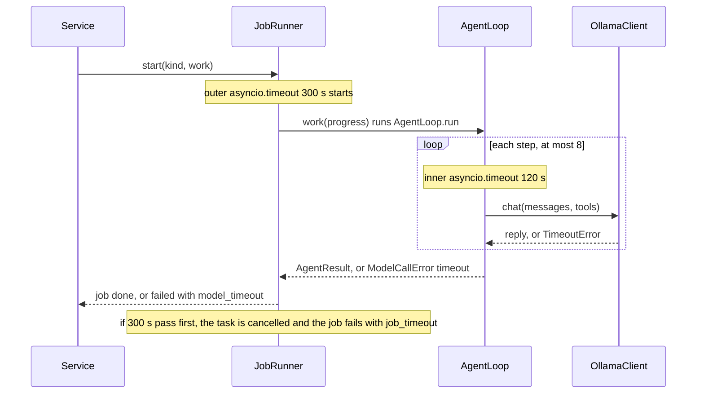

# U1 Foundation - NFR Design Patterns

**Stage**: Construction - NFR Design (plan step 4)
**Source**: `aidlc-docs/construction/plans/u1-foundation-nfr-design-plan.md` (6 answers, all A, chosen by the owner 2026-11-26), `nfr-requirements/nfr-requirements.md`, `nfr-requirements/tech-stack-decisions.md`, Functional Design `business-rules.md` and `business-logic-model.md`, `component-methods.md` (async signatures)
**Scope**: how U1 code carries out the NFR requirements: which pattern, where it lives, and how it is tested. Pattern ids `NP-<n>`. Components are named in `logical-components.md` (ids `LC-<n>`).

---

## 1. Summary

| Id | Pattern | Requirement | Where | Decided by |
|---|---|---|---|---|
| NP-1 | Nested wall-clock deadlines with `asyncio.timeout` | job 300 s, model call 120 s | `services/jobs.py`, `agent/loop.py` | NFR Q4 A, Q5 A; this plan Q1 A |
| NP-2 | Fail fast, no retry, typed errors mapped once | U1-NFR-R.4, R.5 | `services/errors.py`, `agent/llm.py` | FD Q26 A |
| NP-3 | Pre-flight status probe, no cache | ST-1, ST-2, ST-7 | `agent/llm.py`, `services/settings.py` | FD Q17 A |
| NP-4 | Process-wide rate limiter (lock + monotonic clock) with a request deadline | Nominatim 1 req/s, 5 s | `places/lookup.py` | NFR Q6 A; this plan Q3 A |
| NP-5 | Graceful degradation: banner and "no name" instead of exceptions | U1-NFR-R.2, R.3 | pages, `places/lookup.py` | FD Q18 A, Q24 A |
| NP-6 | Blocking SQLite inside async code, no `await` inside a transaction | performance, cancellation | `data/repositories.py` | this plan Q2 A |
| NP-7 | Console logging with `key=value` events and a job context variable | U1-NFR-L.1, L.2 | `trip_journal/logs.py` (new) | NFR Q8 A; this plan Q5 A, Q6 A |
| NP-8 | Hypothesis profiles selected by environment variable | U1-NFR-T.3, T.4, PBT-08, PBT-09 | `tests/conftest.py`, `tests/strategies.py` | NFR Q7 A; this plan Q4 A |
| NP-9 | Injectable limits and clocks for tests | U1-NFR-T.2, T.5 | constructors of LC-2, LC-4, LC-7 | NFR-7.2 |

All limits are constants in `config.py` (LC-1), not Settings-page fields:

| Constant | Value | Used by |
|---|---|---|
| `JOB_TIMEOUT_S` | 300 | `JobRunner(timeout_s=...)` |
| `MODEL_CALL_TIMEOUT_S` | 120 | `AgentLoop(call_timeout_s=...)`, `OllamaClient` SDK timeout |
| `STATUS_TIMEOUT_S` | 2 | `OllamaClient.status` |
| `NOMINATIM_TIMEOUT_S` | 5 | `PlaceLookup` |
| `NOMINATIM_MIN_INTERVAL_S` | 1.0 | `NominatimRateLimiter` |

---

## 2. NP-1 Nested deadlines (job 300 s, model call 120 s)

### 2.1 Design

- **Job deadline (outer)**: `JobRunner` runs each job as one `asyncio` task. The task body is `async with asyncio.timeout(self.timeout_s): result = await work(progress)`. The clock starts when the job is created (`started_at`), after the status check (ST-7), so the check does not count against the 5 minutes.
- **Model-call deadline (inner)**: `AgentLoop` wraps each `LLMClient.chat` call in `async with asyncio.timeout(self.call_timeout_s)`. A `TimeoutError` from this block becomes `ModelCallError("timeout", trace)` (AL-8). Putting the deadline in the loop, not only in the client, means the fake LLM client in tests is timed the same way.
- **Backstop**: `OllamaClient` creates `AsyncOpenAI(base_url=..., timeout=MODEL_CALL_TIMEOUT_S, max_retries=0)`. The SDK timeout is an httpx connect/read timeout, so it only catches a stalled connection; the `asyncio.timeout` above is the real wall-clock limit (plan Q1 A). `max_retries=0` is required: the SDK default of 2 retries would break U1-NFR-R.5.
- **Which limit wins**: Python 3.11+ `asyncio.timeout` blocks nest correctly. The inner block raises `TimeoutError` only when its own deadline passed; when the job deadline passes first, the inner block lets the cancellation through and the outer block raises `TimeoutError` in `JobRunner`, which maps it to `job_timeout`. So a call that starts with 30 s left in the job ends as `job_timeout`, not `model_timeout`.
- **Rules for code inside a job**: never catch `asyncio.CancelledError` or `BaseException`; `except Exception` is fine (it does not catch cancellation). Cleanup uses `try/finally` or `async with`.
- **Ollama side**: cancelling the task closes the HTTP connection. Ollama is expected to stop generating when the client disconnects. **[To verify in Build and Test]**: after a `job_timeout`, `ollama ps` shows no request still running.

### 2.2 Flow



Text alternative: the service starts a job; `JobRunner` opens a 300 s deadline and runs the work, which runs the agent loop. Each model call in the loop has its own 120 s deadline. A call over 120 s fails the job with `model_timeout`. If the whole job reaches 300 s first, the task (and the call in progress) is cancelled and the job fails with `job_timeout`.

### 2.3 Error outcome table

| What happens | Raised where | Job error code |
|---|---|---|
| One call over 120 s (inner deadline) | `AgentLoop` → `ModelCallError("timeout")` | `model_timeout` |
| SDK timeout (`openai.APITimeoutError`) | `AgentLoop` → `ModelCallError("timeout")` | `model_timeout` |
| Other SDK error (`openai.APIError`, connection refused mid-job) | `AgentLoop` → `ModelCallError("error")` | `model_error` |
| Job over 300 s (outer deadline) | `JobRunner` catches `TimeoutError` | `job_timeout` |

---

## 3. NP-2 Fail fast, no retry

- No retry anywhere in U1: not in the SDK (`max_retries=0`), not in the loop, not in `JobRunner` (U1-NFR-R.5). The user presses Try again (ER-3).
- Errors are typed where they happen (`ModelUnavailableError`, `ModelBusyError`, `ModelCallError`, `AgentStepLimitError`, `NotFoundError`) and mapped to a `UserFacingError` in **one** place, `services/errors.py` (ER-2). Anything else becomes `internal_error`, logged with the full exception (U1-NFR-L.2) and shown without a stack trace.
- A failed job keeps its trace up to the failure (JB-4); the trace holds ids only (JB-8).
- Why no circuit breaker: the status probe (NP-3) already runs before every job, and only one job runs at a time.

## 4. NP-3 Pre-flight status probe

- `OllamaClient.status()` sends `GET {server root}/api/tags` with an `httpx.AsyncClient(timeout=STATUS_TIMEOUT_S)`. Connection refused, timeout or non-200 → `reachable = False` (ST-2, ST-3).
- It runs on every full page load (banner) and right before `JobRunner.start` (ST-1, ST-7); no result is cached, so starting Ollama fixes the banner on the next load (US-19 S4).
- A page load waits at most 2 s for the probe when Ollama is down.

## 5. NP-4 Nominatim rate limiter (1 request/s, 5 s)

### 5.1 Design (plan Q3 A)

One `NominatimRateLimiter` per process, owned by `PlaceLookup`. It holds an `asyncio.Lock` and the monotonic time of the last request start.

```text
async with limiter.lock:
    wait = limiter.last_start + MIN_INTERVAL - clock()
    if wait > 0: await sleep(wait)
    limiter.last_start = clock()
    async with asyncio.timeout(NOMINATIM_TIMEOUT_S):
        response = await http.get(url, params, headers, timeout=NOMINATIM_TIMEOUT_S)
```

- The lock is held from the wait through the end of the request, so requests never overlap and each starts at least 1 s after the previous one started.
- The 5 s limit covers the HTTP request only; the wait for the lock is not counted (plan Q3 A). The `asyncio.timeout(5)` gives a wall-clock limit; the httpx `timeout=5` is a backstop for a stalled connection (same reasoning as NP-1).
- `last_start` is set before the request, so a failed or timed-out request still counts toward the 1 s spacing.
- A job cancelled while waiting leaves the `async with` block, so the lock is released.
- Only called on a cache miss with lookup on (PL-4, PL-5). Any `httpx.HTTPError`, `TimeoutError`, non-200 or missing name → `name = None`, `source = "none"`, logged at WARNING with the reason (no coordinates beyond the rounded key) (PL-8).
- `clock` (default `time.monotonic`) and `sleep` (default `asyncio.sleep`) are constructor arguments so tests check the spacing without waiting (NP-9).

## 6. NP-5 Graceful degradation

| Failure | Behaviour | Rule |
|---|---|---|
| Ollama down or model missing | Pages load and show the banner; LLM actions return `ModelUnavailableError` before any job is created | ST-4, ST-7 |
| Nominatim offline, slow or erroring | `lookup_place` returns no name; the agent carries on | PL-8 |
| Tool raises | `tool_failed` result to the model; the loop continues | TA-9, AL-5 |
| Invalid environment value | warning logged, next level used | SE-6, L.1 |

## 7. NP-6 SQLite in async code (plan Q2 A)

- Repositories are plain (sync) functions on `sqlite3`, called directly from `async` code without `asyncio.to_thread`. U1 queries are local and take milliseconds.
- Effect on timeouts: a cancellation takes effect at the next `await`, so a deadline can be late by at most one running query.
- Rule: no `await` while a transaction is open (commit or roll back first), so two coroutines never interleave inside one transaction.
- If a later unit adds slow queries, it can move them to `asyncio.to_thread` without changing callers' signatures (repository methods stay sync; the async caller decides).

## 8. NP-7 Console logging (plan Q5 A, Q6 A)

### 8.1 Setup

- `trip_journal/logs.py` (new module) has `setup_logging()`. `main.py` calls it once before the app starts and runs uvicorn with `log_config=None`, so uvicorn does not install its own format.
- One `StreamHandler(sys.stderr)` on the root logger. Level from `TRIP_JOURNAL_LOG_LEVEL` (DEBUG, INFO, WARNING, ERROR, any case); missing → INFO; invalid → INFO plus one WARNING line naming the bad value (U1-NFR-L.1).
- Loggers `uvicorn`, `uvicorn.error` and `uvicorn.access` have their own handlers removed and propagate to the root handler, so all lines share one format and level. Access lines stay on at INFO (plan Q6 A); they show method, path and status only, and U1 forms use POST, so no note text reaches a URL.
- Loggers are per module: `logging.getLogger(__name__)`.

### 8.2 Line format

```text
2026-11-26 05:40:12,345 INFO trip_journal.services.jobs job_id=3f2a... job.done kind=journal duration_s=118.4 steps=4
2026-11-26 05:40:13,002 INFO uvicorn.access job_id=- 127.0.0.1:51034 - "GET /api/jobs/3f2a... HTTP/1.1" 200
```

- Formatter: `%(asctime)s %(levelname)s %(name)s job_id=%(job_id)s %(message)s`.
- `job_id` comes from a `ContextVar[str | None]` (`current_job_id`). `JobRunner` sets it as the first line of the job task, so every line logged inside that task (loop, tools, place lookup) carries it; outside a job it prints `-`. A logging `Filter` on the handler copies the value onto each record.
- Messages are `event key=value ...`, built by a small helper `kv(event, **fields)`. Values with spaces are quoted with `repr`.

### 8.3 Events

| Event | Level | Fields |
|---|---|---|
| `job.start` | INFO | `kind`, `model` |
| `job.done` | INFO | `kind`, `duration_s`, `steps` |
| `job.failed` | WARNING (ERROR for `internal_error`, with the exception) | `kind`, `code`, `duration_s` |
| `agent.step` | INFO | `step`, `duration_s` |
| `tool.call` | INFO | `tool`, `returned_ids`, `error_kind` (if any) |
| `status.check` | DEBUG when fine, WARNING when bad | `reachable`, `model_installed` |
| `settings.fallback` | WARNING | `setting`, `level` (saved / env) |
| `place.lookup` | DEBUG | `source`, `key` (rounded only) |
| `log.level_invalid` | WARNING | `value` |

Never logged (U1-NFR-L.2, SP.4): note text, journal text, prompts, model replies, tool argument text other than ids, unrounded coordinates. A test runs a fake job whose notes contain a marker string and checks with `caplog` that the marker is in no log line.

## 9. NP-8 Hypothesis profiles (plan Q4 A)

`tests/conftest.py`:

```text
settings.register_profile("default", max_examples=100, deadline=None, print_blob=True)
settings.register_profile("ci",      max_examples=500, deadline=None, print_blob=True)
settings.load_profile(os.environ.get("HYPOTHESIS_PROFILE", "default"))
```

- `deadline=None` in both profiles: a slow laptop never fails a test only because one example took long (plan Q4 A). Tests that must be fast use their own explicit limits, not the Hypothesis deadline.
- Shrinking stays on (the default). `print_blob=True` prints the shrunk input and a `@reproduce_failure` blob (PBT-08).
- Example database: the default `.hypothesis/` directory, git-ignored; failing examples are replayed first on the next run.
- An unknown `HYPOTHESIS_PROFILE` value makes Hypothesis raise at start, so a typo fails loudly.
- Pre-merge run (PowerShell): `$env:HYPOTHESIS_PROFILE = 'ci'; uv run pytest --hypothesis-seed=<n>`. The explicit seed is in the command and the log, so a failure can be replayed (PBT-08).
- Generators live in `tests/strategies.py` (trips, stops, notes, photos, settings values, coordinates, citation texts) and respect the business rules (PBT-07). Property tests are listed in `business-rules.md` §10.

## 10. NP-9 Injectable limits and clocks

| Component | Injected | Test use |
|---|---|---|
| `JobRunner` | `timeout_s` | `0.05` with a work function that sleeps 1 s → `job_timeout` |
| `AgentLoop` | `call_timeout_s` | `0.05` with a `FakeLLMClient` reply that sleeps → `model_timeout` |
| `NominatimRateLimiter` | `clock`, `sleep` | fake clock checks the 1 s spacing without waiting |
| `OllamaClient`, `PlaceLookup` | `httpx` transport | `httpx.MockTransport` raising `httpx.ConnectError` / `httpx.ReadTimeout` |

No test needs Ollama or the network (U1-NFR-T.5); no test waits for a real 120 s or 300 s.

## 11. Extension compliance

| Extension / rule | Status | Note |
|---|---|---|
| Security Baseline | N/A (opted out) | Skipped per `aidlc-state.md` |
| Resiliency Baseline | N/A (opted out) | Skipped; NP-1 to NP-5 come from the project's own NFRs |
| PBT-08 reproducibility (blocking) | Compliant (design) | `print_blob=True`, example database, explicit seed in the pre-merge run (NP-8) |
| PBT-09 framework (blocking) | Compliant | Hypothesis, profiles in `tests/conftest.py` (NP-8) |
| PBT-07 generators (blocking) | Compliant (design) | one shared `tests/strategies.py`; checked at Code Generation |
| PBT-02, PBT-03 (blocking) | N/A at this stage | Properties are written at Code Generation |
| Other PBT rules (advisory) | N/A at this stage | |
