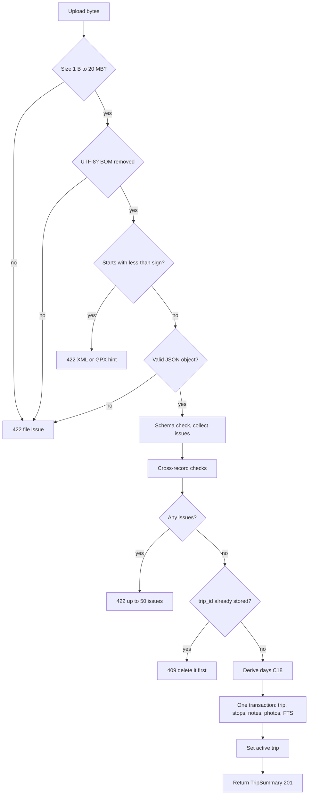

# U2 Import and Timeline - Business Logic Model

**Stage**: Functional Design (U2), answers all A (2026-11-27)
**Covers**: C03 ImportService, C04 TripService, C17 Import Schema and Validation, C18 Day Derivation, C25 minimal sample trip
**Rule ids** (IM-, DD-, TL-, AT-, DL-) are defined in `business-rules.md`.

---

## 1. Import pipeline (C03 `ImportService.import_trip(raw, filename)`)

Import, browsing and deleting never use the JobRunner or the model (U1 `services.md` rule 2), so they work while Ollama is down or busy.

Text alternative: size check, UTF-8 decode, XML/GPX hint, JSON parse, schema check, cross-record checks; any issue gives 422. A valid file whose `trip_id` is already stored gives 409. Otherwise days are derived, everything is stored in one transaction, the new trip becomes active and its summary is returned.

Steps in detail:
1. **Size** (IM-1): 0 bytes → "The file is empty." More than 20 MB (20 × 1024 × 1024 bytes) → "The file is larger than 20 MB." Checked before any parsing. The page and the API both read at most 20 MB + 1 byte from the upload, so a huge upload is never held whole in memory.
2. **Decode** (IM-2): UTF-8; a leading BOM is removed. Failure → "The file is not UTF-8 text. Only the JSON trip format is supported."
3. **Type hint** (IM-3): after leading whitespace, a first character `<` → "This looks like an XML/GPX file. Only the JSON trip format is supported." The file name is never used to decide the type (Q10).
4. **JSON** (IM-4): parse error → "The file is not valid JSON (line L, column C)." A top-level value that is not an object → "The file must contain one JSON object."
5. **Schema** (IM-5..IM-9): Pydantic validation of `TripFile`. Every Pydantic error is turned into an `ImportIssue` with a dotted path (`stops[4].end_utc`) and a plain message (business-rules 1.3). No content from the file is executed or evaluated (no `eval`, `exec`, `pickle`; US-01 rule).
6. **Cross-record checks** (IM-10..IM-13), run on the records that passed the schema: unique ids per type, `notes[].stop_id` exists, `end_utc >= start_utc`, photo `lat`/`lon` both or neither. Steps 5 and 6 report together (Q9).
7. **Issues** → `ImportValidationError(issues[:50], more)`; nothing is stored (IM-14).
8. **Duplicate** (IM-15, Q11): `TripRepository.get_by_source_id(trip.trip_id)` exists → `TripAlreadyExistsError`. A `sqlite3.IntegrityError` on `trips.source_id` from a parallel import is turned into the same error.
9. **Derive** (section 2): `local_date` for each stop; each note's day (DD-3); each photo's `local_time`.
10. **Store** in one transaction (IM-16): trip row, stops in day order (DD-4), notes, photos; FTS5 rows come from U1's triggers. Any error rolls back everything.
11. **Active trip** (AT-1): `settings.active_trip_id` = the new row id.
12. Return `TripSummary` with one `DaySummary` per trip day (section 3.1).

---

## 2. Day derivation (C18 `domain/days.py`, pure functions)

### 2.1 `local_date(time_utc, utc_offset_minutes) -> LocalDate`
`(time_utc + offset minutes).date()` as `YYYY-MM-DD`. The offset is the record's own; `home_timezone` is never used (Q3). This is the only place the rule lives (IC-3).

### 2.2 Stops: `group_stops_by_day(stops)`
- Key = `local_date(stop.start_utc, stop.utc_offset_minutes)` (FR-2.1, DD-1).
- **Stop past midnight**: a stop 23:10 to 01:30 local has its start on day D, so it is in D only, never in D+1 (US-04 Scenario 2). Its end time is shown as `01:30 +1 day`.
- **Different offsets**: each stop uses its own offset (US-04 Scenario 3). Example: a stop at `2026-05-02T23:30Z` with offset +60 is on 2026-05-03; one at `2026-05-02T23:30Z` with offset -300 is on 2026-05-02.
- Within a day: order by `start_utc`, then `end_utc`, then `source_id` (DD-4). Order is by real (UTC) time, so a day that crosses a time-zone change stays in true order even if local clock times look out of order.

### 2.3 Notes
- With `stop_id`: the stop's `local_date` (Q12, DD-3). A note at 00:50 on the 23:10 dinner stop is on the dinner's day.
- Without `stop_id`: `local_date` of its own time and offset.

### 2.4 Photos
- `local_time` = naive local ISO of its own time and offset (U1 column, used by `find_photos`).
- Day placement and stop placement happen at view time (3.3).

### 2.5 Trip days: `build_day_index(...) -> list[LocalDate]` (Q15, DD-5)
The sorted set of: every stop's `local_date`; the `local_date` of every note without a stop; the local date of every photo that is in no stop's window. Empty dates between them are not days. `day_number` = position + 1.

---

## 3. Trips and the day view (C04 `TripService`)

### 3.1 `list_trips()`
All trips, newest import first (U1 `TripRepository.list` order). Each `TripSummary` has its days and counts. Per-day counts: stops by `local_date`; notes by their stored `local_date`; photos by their placement in 3.3 (a photo in a stop counts on the stop's day).

### 3.2 `get_day(trip_id, day) -> DayView`
1. Trip missing → `NotFoundError("trip_not_found")` (TL-1).
2. Build the day index (2.5); `day` not in it → `NotFoundError("day_not_found")` (TL-2).
3. Stops for the day in DD-4 order. Each stop gets its notes (`stop_id` match, ordered by `time_utc`, `source_id`) and its photos (3.3).
4. `unlinked_notes`: notes of this day without a stop, in time order (Q14).
5. `other_photos`: photos of this day (by own local date) that are in no stop (Q13).
6. `prev_date` / `next_date` from the day index; `None` on the first / last day (US-04 Scenario 4).
7. `show_offsets` = the day's stops do not all share one offset (Q16).
8. `organized = None` on every stop: the slot U3 fills (`unit-of-work.md` "Provides").
9. No call to PlaceLookup or the model (Q17). A stop without a name shows "Unnamed place" and its coordinates.

### 3.3 Photo placement: `assign_photos(stops, photos)` (Q13, DD-6)
For each photo, the candidate stops are those with `start_utc <= photo.time_utc <= end_utc` (UTC, inclusive). None → "Other photos" on the photo's own local date. One or more → the stop with the latest `start_utc` (ties: latest `source_id`). Computed at view time; nothing is stored, so no U1 table changes.

---

## 4. Active trip (C04, AT-1..AT-5)
- Stored in `settings` as `active_trip_id` (U1 `SettingsRepository`).
- Set by: a successful import; opening a trip overview or a day page (`set_active_trip`); choosing "Make active" in the trip list.
- `get_active_trip_id()`: the stored id if that trip exists; otherwise the most recently imported trip (and the setting is updated); otherwise `None`.
- The base layout shows the active trip's title (link to its overview) or "No trip selected" on every page (US-02 rule).
- Every trip-scoped service and the agent's `ToolContext` take the trip id from here; U2 never mixes data from two trips (US-02 Scenario 2 is tested again in U5).

---

## 5. Delete a trip (C04, DL-1..DL-4)
1. `GET /trips/{id}/delete` → `get_delete_preview(id)`: title and counts; text "This also deletes all journals and note decisions for this trip." Nothing changes (US-03 Scenario 2).
2. Cancel → back to `/trips/{id}`; nothing changes (Scenario 3).
3. `POST /trips/{id}/delete` → `delete_trip(id)`: one `DELETE FROM trips`; the cascade removes stops, notes, photos, FTS rows and every U3/U4 table row (they must reference `trips.id` with `ON DELETE CASCADE`, U1 rule 1.4). Then AT-4 picks the new active trip. Redirect to `/trips` with "Trip deleted."
4. After the delete, the same file imports again (Scenario 4), because `source_id` is free.

---

## 6. Minimal sample trip (C25, `sample_data/minimal_trip.json`, Q22 A)

Synthetic data, public places, no personal data. `trip.trip_id` = `"minimal-lisbon-2026-05"`, title "A day in Lisbon", `home_timezone` "Europe/Lisbon", offset +60 for every record (Lisbon summer time). Local date of the only day: **2026-05-02 (Sat)**. Local time = UTC + 1 h.

### 6.1 Stops (4)
| id | name | local start - end | lat, lon | Covers |
|---|---|---|---|---|
| `s1` | Café A Brasileira | 09:15 - 10:00 | 38.7107, -9.1424 | normal stop |
| `s2` | *(none)* | 10:40 - 11:30 | 38.7118, -9.1301 (Miradouro de Santa Luzia) | missing name, `lookup_place` (US-17), "Unnamed place" |
| `s3` | Museu Nacional do Azulejo | 14:00 - 16:30 | 38.7246, -9.1136 | normal stop |
| `s4` | Late dinner in Bairro Alto | 23:10 - 01:30 (+1 day) | 38.7134, -9.1446 | stop past midnight (US-04 Scenario 2) |

### 6.2 Notes (8)
| id | stop | local time | Text (summary) | Covers |
|---|---|---|---|---|
| `n1` | s1 | 09:30 | pastel de nata and a bica at the counter, crowded | normal |
| `n2` | s1 | 09:50 | price 2.80 EUR for both | fact for Q&A |
| `n3` | s2 | 10:50 | view over Alfama and the river, tiles | note on unnamed stop |
| `n4` | s3 | 14:20 | the long Lisbon panorama tile panel is the highlight | normal |
| `n5` | s3 | 16:10 | mixed English/Portuguese: "Gift shop: comprei dois azulejos pequenos, muito bonitos - 12 EUR total." | mixed language (FR-3.5) |
| `n6` | *(none)* | 12:45 | lunch on a bench, tram 28 passed twice | unlinked note (Q14) |
| `n7` | s4 | 23:30 | bacalhau à Brás and vinho verde, service slow but friendly | normal |
| `n8` | s4 | 00:50 (+1 day) | walked back after 1 am, streets still busy | note past midnight stays on day 1 (Q12) |

### 6.3 Photos (10)
`p1` 09:20 and `p2` 09:40 (s1); `p3` 10:45, `p4` 11:00, `p5` 11:20 (s2); `p6` 12:30 with coordinates, in no stop (Other photos, Q13); `p7` 14:30 (s3); `p8` 15:45 without coordinates (s3); `p9` 23:20 (s4); `p10` 00:40 +1 day (s4, past midnight). File names `IMG_0001.jpg` to `IMG_0010.jpg`.

### 6.4 Expected results (used as test oracle)
One day, 2026-05-02, `day_number` 1, no previous or next day. Counts: 4 stops, 8 notes, 10 photos. `s4` shows `23:10 - 01:30 +1 day` with `n7`, `n8`, `p9`, `p10`. Unlinked notes: `n6`. Other photos: `p6`. `show_offsets` false.

### 6.5 Fixture loader (`tests/fixtures/`)
`load_minimal_trip(services) -> TripSummary` imports the file through `ImportService` into the test database, and `minimal_trip_ids(conn) -> dict[str, int]` maps file ids (`"s4"`) to row ids, so U3-U6 tests can cite records by their file id. `docs/import-format.md` uses this file as its full example.

---

## 7. Carry-ins for Code Generation (from U1 `build-and-test-summary.md`)
Recorded here so Code Generation plans them. They are not part of U2's business logic and are not designed away.

| # | Finding | Item for U2 Code Generation |
|---|---|---|
| CI-1 | Port 8000 is hardcoded (`config.py` `PORT`); Docker/WSL holds it on the owner's laptop | Add a port override (for example env `TRIP_JOURNAL_PORT`, default 8000) used by `main.py` |
| CI-2 | Nav link `/trips` returns 404 | U2's `GET /trips` page (frontend-components 2.1) fixes it; add an API/page test that `/trips` is 200 |
| CI-3 | A manual cancel is reported as `job_timeout` (`services/jobs.py` raises `JobTimeoutError("job cancelled")`) | Report a manual cancel as `job_cancelled` with its own message; keep `job_timeout` for the 5-minute deadline. U2 adds no cancel button itself, so Code Generation decides with the owner whether this U1 fix lands in U2 or with the first unit that shows a cancel button |
