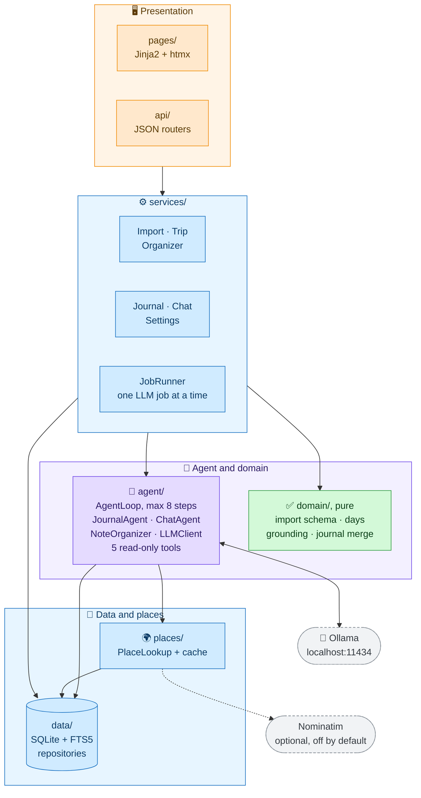

# Application Design: Trip Journal Agent

This document consolidates the application design. The details are in:
- `components.md`: 25 components and their responsibilities
- `component-methods.md`: method signatures and data contracts
- `services.md`: services and request flows
- `component-dependency.md`: dependency matrix, communication patterns and data flow

**Inputs**: `requirements.md`, `stories.md`, `personas.md`, `execution-plan.md`, `application-design-plan.md` (design answers Q1–Q13), `docs/technical-environment.md`

---

## 1. Design Decisions

| # | Decision | Effect on the design |
|---|---|---|
| Q1 | One shared `AgentLoop` | JournalAgent and ChatAgent are thin wrappers (prompt + tool set); the 8-step cap and argument validation are built and tested once |
| Q2 | The organizer makes one structured call per day, with no tools | NoteOrganizer calls the LLM client directly and validates JSON into `NoteSuggestion` |
| Q3 | New `services/` package | Seven services hold every request flow; routers stay thin. This adds a package to the structure in `technical-environment.md` |
| Q4 | Pages and API are two front doors over the same services | HTML and htmx fragments from `pages/`, JSON from `api/` |
| Q5 | Background job plus htmx polling | `JobRunner` plus `GET /jobs/{id}` about once a second show the current agent step (FR-4.7) |
| Q6 | One LLM job at a time | A second request gets "model busy" (HTTP 429 in the API) |
| Q7 | Flat import lists with references | `TripFile{trip, stops[], notes[], photos[]}`, `extra="forbid"`; notes reference stops by file id |
| Q8 | SQLite row ids in citations | `[stop:12]` is unique across trips; each record also keeps its file `source_id` for the evaluation labels |
| Q9 | Paragraphs identified by slot | Slots are `summary` or a `stop_id`; regenerate fills only generated slots |
| Q10 | Journal traces saved; chat traces not | "How this was made" is shown again for a saved journal; chat traces stay in the page |
| Q11 | Environment defaults, overridden by a SQLite settings table | A Settings page changes the model, the URL and place lookup without a restart |
| Q12 | `LLMClient` protocol | `OllamaClient` (openai SDK) and `FakeLLMClient` (tests) injected through `Depends` |
| Q13 | In-process evaluation script | `scripts/evaluate.py` calls the service coroutines against a temporary database |

Additional design decision: **`save_journal` is a service step, not a tool.** The model is offered only the five read-only tools, so it has no way to write data. JournalService performs the save, which writes generated paragraphs only (FR-6.4, NFR-3.6).

---

## 2. Architecture Overview

Text alternative: there are five layers. The pages and the JSON API call the services. The services call the agent components and the pure domain functions. The agent's tools read through the data repositories and PlaceLookup. The LLM client calls Ollama on localhost, and PlaceLookup calls Nominatim only when the user has turned it on.

---

## 3. Components (summary)

| Id | Component | Package | Main stories |
|---|---|---|---|
| C01 | Page Routes | `pages/` | US-01 to US-20 |
| C02 | JSON API Routers | `api/` | all; US-23 |
| C03 | ImportService | `services/` | US-01, US-03, US-21 |
| C04 | TripService | `services/` | US-02, US-03, US-04, US-05 |
| C05 | OrganizerService | `services/` | US-06, US-07, US-08 |
| C06 | JournalService | `services/` | US-09 to US-13, US-20 |
| C07 | ChatService | `services/` | US-14, US-15, US-16, US-20 |
| C08 | SettingsService | `services/` | US-17, US-18, US-19 |
| C09 | JobRunner | `services/` | US-06, US-09, US-14, US-19 |
| C10 | LLM Client (protocol, Ollama, Fake) | `agent/` | US-18, US-19 |
| C11 | AgentLoop | `agent/` | US-09, US-14, US-20 |
| C12 | Tool Registry and Tools | `agent/` | US-09, US-14, US-17 |
| C13 | JournalAgent | `agent/` | US-09, US-13 |
| C14 | ChatAgent | `agent/` | US-14, US-15, US-16 |
| C15 | NoteOrganizer | `agent/` | US-06 |
| C16 | Prompt Library | `agent/prompts/` | US-06, US-09, US-14 |
| C17 | Import Schema and Validation | `domain/` | US-01, US-21 |
| C18 | Day Derivation | `domain/` | US-04 |
| C19 | Citations and Grounding | `domain/` | US-10, US-11, US-14, US-16 |
| C20 | Journal Merge | `domain/` | US-13 |
| C21 | Database | `data/` | all stories that store data |
| C22 | Repositories | `data/` | all stories that read or store data |
| C23 | PlaceLookup | `places/` | US-17 |
| C24 | Evaluation Runner | `scripts/`, `evaluation/` | US-22, US-23, US-24 |
| C25 | Sample Data | `sample_data/` | US-21 |

**Story coverage check**: every story US-01 to US-24 is served by at least one component above.

---

## 4. Key Interfaces

### Agent tools (offered to the model; all read-only and scoped to the active trip)

| Tool | Arguments (Pydantic) | Returns (with record ids) |
|---|---|---|
| `list_day_stops` | `day: LocalDate` | Stops with id, name, local start and end, coordinates, note count, photo count |
| `get_stop_notes` | `stop_id: int` | Notes with id, text, local time and organized fields if accepted |
| `find_photos` | `start_local, end_local: datetime` | Photo ids with local time and location |
| `search_notes` | `query: str (1–100 chars), limit ≤ 20` | Note hits (id, stop id, snippet) from FTS5 |
| `lookup_place` | `lat (−90..90), lon (−180..180)` | Place name plus source (import, cache, nominatim or none) |

### Main service methods

| Service | Methods |
|---|---|
| ImportService | `import_trip(raw, filename) -> TripSummary` |
| TripService | `list_trips`, `get_active_trip_id`, `set_active_trip`, `get_day`, `delete_trip` |
| OrganizerService | `start`, `organize_now`, `list_suggestions`, `accept`, `edit_and_accept`, `reject`, `accept_all_pending` |
| JournalService | `start_generation`, `generate_now`, `get_journal`, `edit_paragraph` |
| ChatService | `start_question`, `answer_now` |
| SettingsService | `get`, `update`, `model_status` |
| JobRunner | `start`, `status` |

### JSON API (outline; exact paths are fixed in Functional Design)

| Method and path | Purpose |
|---|---|
| `POST /api/trips`, `GET /api/trips`, `DELETE /api/trips/{trip_id}` | Import, list and delete trips |
| `GET /api/trips/{trip_id}/days`, `GET /api/trips/{trip_id}/days/{local_date}` | Days and the day timeline |
| `POST /api/trips/{trip_id}/organize` | Start the organizer (day or whole trip) |
| `GET /api/trips/{trip_id}/days/{local_date}/suggestions`, `POST /api/suggestions/{id}/accept`, `/edit`, `/reject`, `POST /api/trips/{trip_id}/days/{local_date}/suggestions/accept-all` | Review suggestions |
| `POST /api/trips/{trip_id}/days/{local_date}/journal`, `GET` the same path, `PUT .../journal/paragraphs/{slot}` | Generate or regenerate, read, edit |
| `POST /api/trips/{trip_id}/chat` | Ask a question (the body carries the history) |
| `GET /api/jobs/{job_id}` | Job progress and result |
| `GET /api/settings`, `PUT /api/settings`, `GET /api/settings/model-status` | Settings and model status |

### Errors

`ImportValidationError` (422), `TripAlreadyExistsError` (409), `NotFoundError` (404), `ModelUnavailableError` (503), `ModelBusyError` (429), and `AgentStepLimitError` (the job ends as `failed`, with the trace).

---

## 5. Main Flows (see `services.md` for the diagrams)

1. **Import**: validate → reject duplicates → derive days → store in one transaction.
2. **Organize**: model check → job → one structured call per day → pending suggestions → review (accept, edit, reject or accept all; no LLM).
3. **Journal**: model check → job → load saved slots → JournalAgent writes only non-user slots → merge → grounding → save step (generated paragraphs, tone, trace, prompt version).
4. **Edit**: mark as user-owned → re-check grounding → autosave.
5. **Q&A**: model check → job → ChatAgent with the page-held history → grounding with the "not in your records" exemption → returned, not stored.
6. **Place lookup**: setting off → imported name; otherwise cache → rate-limited Nominatim → fall back on failure.
7. **Evaluation**: temporary database → import the samples → call the `*_now` service coroutines → compare with labels by `source_id` → report against the targets.

---

## 6. How the Design Meets the Non-Functional Requirements

| NFR | Design element |
|---|---|
| NFR-1 Performance | Tools fetch only the records needed; one LLM job at a time; organizer batched per day; timings reported by the evaluation runner |
| NFR-2 Privacy | Server bound to `127.0.0.1`; no hosted provider in `Settings`; PlaceLookup off by default; temporary database for evaluation |
| NFR-3 Security | `extra="forbid"` import models; validated tool arguments; tools read-only and trip-scoped; no write tool; Jinja2 autoescape; tool results delimited as data |
| NFR-4 Reliability | Model check before jobs; `ModelBusyError`; step-limit result with trace; one write transaction at the end of a flow; cascading deletes |
| NFR-5 Usability | Polling progress text; highlights shown with an icon and text; errors that say what to do next |
| NFR-6 Maintainability | Downward-only layers; SQL only in repositories; prompts versioned in `agent/prompts/`; no prohibited libraries |
| NFR-7 Testability | `FakeLLMClient` through `Depends`; pure domain functions; `tests/property/` kept separate for property-based tests |

**Property-based testing (Partial mode) candidates for Functional Design** (PBT-01 is advisory in Partial mode; PBT-02 and PBT-03 are blocking at code generation):
- Round-trip (PBT-02): `TripFile` → stored records → exported view keeps every id and value; `extract_citations` on citations formatted from generated ids.
- Invariants (PBT-03): `merge_journal` never changes a user-owned paragraph and always returns every slot in order; `check_text` flags exactly the sentences whose citations are empty or outside the known set; `group_stops_by_day` keeps every stop exactly once.

---

## 7. Items for Functional Design (Construction)

- The exact database columns, indexes and FTS5 configuration
- The full import schema reference document and its error messages
- Sentence-splitting rules (abbreviations, quotes, sentences in Chinese)
- The prompt texts and the JSON reply format for journal slots and organizer suggestions
- Final API paths, request and response models, and htmx fragment names
- Rounding of the place-cache key (coordinate precision)
