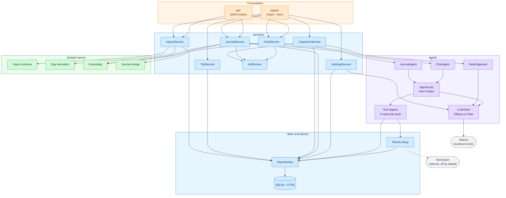
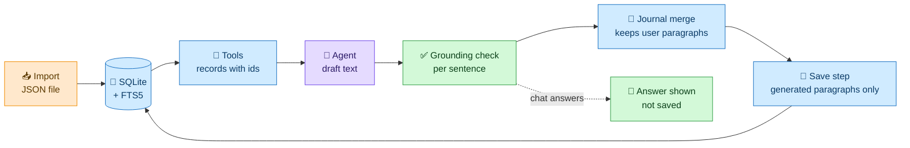

# Component Dependencies

## Layer Rule

Dependencies point **downward only**:

`pages/`, `api/` → `services/` → `agent/`, `domain/` → `data/`, `places/`

- `domain/` is pure. It imports only the standard library and Pydantic, never `data/`, `agent/` or I/O.
- `agent/` may use `domain/` models (for example `Citation`) and reaches data only through the tool context: repositories and PlaceLookup. The agent loop never runs SQL (NFR-6.3).
- `services/` is the only layer that combines agent output with domain checks and writes.
- `pages/` and `api/` never import `agent/`, `data/` or `places/` directly.
- This adds `services/` to the structure in `technical-environment.md` (design Q3 A). The original rule `api/pages → agent/domain → data` still holds, with services in between.

## Package Dependency Matrix

Read across: the row package **depends on** the column package. `✓` = allowed and used · `–` = not allowed.

| depends on → | pages | api | services | agent | domain | data | places | config |
|---|---|---|---|---|---|---|---|---|
| **pages** | | – | ✓ | – | ✓ (view models only) | – | – | – |
| **api** | – | | ✓ | – | ✓ (view models only) | – | – | – |
| **services** | – | – | | ✓ | ✓ | ✓ | ✓ | ✓ |
| **agent** | – | – | – | | ✓ | ✓ (via ToolContext) | ✓ (via ToolContext) | – |
| **domain** | – | – | – | – | | – | – | – |
| **data** | – | – | – | – | ✓ (models) | | – | ✓ |
| **places** | – | – | – | – | – | ✓ (cache repo) | | – |
| **scripts/evaluate.py** | – | – | ✓ | – | ✓ | ✓ (temp DB setup) | – | ✓ |

## Component Dependencies

| Component | Depends on | Used by |
|---|---|---|
| C01 Page Routes | C03–C09 services, domain view models | Browser (htmx) |
| C02 JSON API Routers | C03–C09 services | API tests, any future client |
| C03 ImportService | C17 Import Schema, C18 Day Derivation, C22 Repositories | C01, C02, C24 |
| C04 TripService | C22 Repositories, C18 Day Derivation | C01, C02 |
| C05 OrganizerService | C09 JobRunner, C15 NoteOrganizer, C22, C08 | C01, C02, C24 |
| C06 JournalService | C09, C13 JournalAgent, C19 Grounding, C20 Merge, C22, C08 | C01, C02, C24 |
| C07 ChatService | C09, C14 ChatAgent, C19 Grounding, C22, C08 | C01, C02, C24 |
| C08 SettingsService | C22 SettingsRepository, `config`, C10 LLM Client (status) | C05, C06, C07, C23, C01, C02 |
| C09 JobRunner | (none; runs work passed in) | C05, C06, C07 |
| C10 LLM Client | `openai` SDK (OllamaClient only) | C11, C15, C08 |
| C11 AgentLoop | C10, C12 | C13, C14 |
| C12 Tool Registry and Tools | C22 Repositories, C23 PlaceLookup, C19 Citation model | C11 |
| C13 JournalAgent | C11, C16 Prompts | C06 |
| C14 ChatAgent | C11, C16 Prompts | C07 |
| C15 NoteOrganizer | C10, C16 Prompts | C05 |
| C16 Prompt Library | prompt files | C13, C14, C15 |
| C17–C20 Domain | standard library, Pydantic | Services, tools (models), tests |
| C21 Database | `sqlite3` | C22 |
| C22 Repositories | C21 | Services, tools, C23 |
| C23 PlaceLookup | httpx, C22 PlaceCacheRepository, C08 (switch) | C12 |
| C24 Evaluation Runner | Services, C21 (temporary DB), `evaluation/`, `sample_data/` | Team (US-23) |

There are no cycles. PlaceLookup reads the place-lookup switch through a small read-only settings view passed in at construction, so `places/` does not import `services/`.

## Dependency Diagram

**Text alternative**
- Presentation: `pages/` and `api/` call the services. (The diagram shows only the API's main edges; the API calls every service, as the pages do.)
- Services: ImportService uses the import schema, day derivation and repositories. TripService uses repositories. OrganizerService uses the JobRunner, NoteOrganizer and repositories. JournalService uses the JobRunner, JournalAgent, grounding, merge and repositories. ChatService uses the JobRunner, ChatAgent and grounding. SettingsService uses repositories and the LLM client's status check.
- Agent: JournalAgent and ChatAgent share the AgentLoop. The loop uses the LLM client and the tool registry. NoteOrganizer calls the LLM client directly (no tools). Tools read through repositories and PlaceLookup.
- Data: repositories use SQLite with FTS5. PlaceLookup uses the cache repository and, only when turned on, Nominatim. The LLM client calls Ollama on localhost.

## Communication Patterns

| Path | Pattern | Notes |
|---|---|---|
| Browser → pages | HTTP + htmx (HTML fragments) | Form posts and `hx-get` / `hx-post`; no JavaScript build step |
| Page progress | Short polling (`hx-trigger="every 1s"`) on `/jobs/{id}` | Stops when the job is `done` or `failed` (design Q5 A) |
| Client → api | JSON over HTTP | Pydantic request and response models |
| Routers → services | In-process method calls, injected with `Depends` | Services are created per app with shared repositories |
| Services → JobRunner | In-process background task (`asyncio` task) | One LLM job at a time; others get `ModelBusyError` (design Q6 A) |
| AgentLoop → LLM | `openai` SDK chat completions with `tools` | Async; timeout per call; base URL and model from settings |
| AgentLoop → tools | Validated function call with a `ToolContext` | Results returned to the model as delimited JSON data |
| Tools → data | Repository method calls | Read-only |
| PlaceLookup → Nominatim | httpx async GET | Only when turned on; at most 1 request per second; cached |
| Services → SQLite | `sqlite3` with one transaction per write flow | Foreign keys with cascading deletes |

## Data Flow: Journal and Q&A Records

Text alternative: an import file is stored in SQLite. The tools read records, with their ids, for the agent. The agent's draft goes through the grounding check and then the journal merge, which keeps user paragraphs. The save step writes only generated paragraphs back to SQLite. Chat answers follow the same path up to the grounding check and are then returned without being saved.
