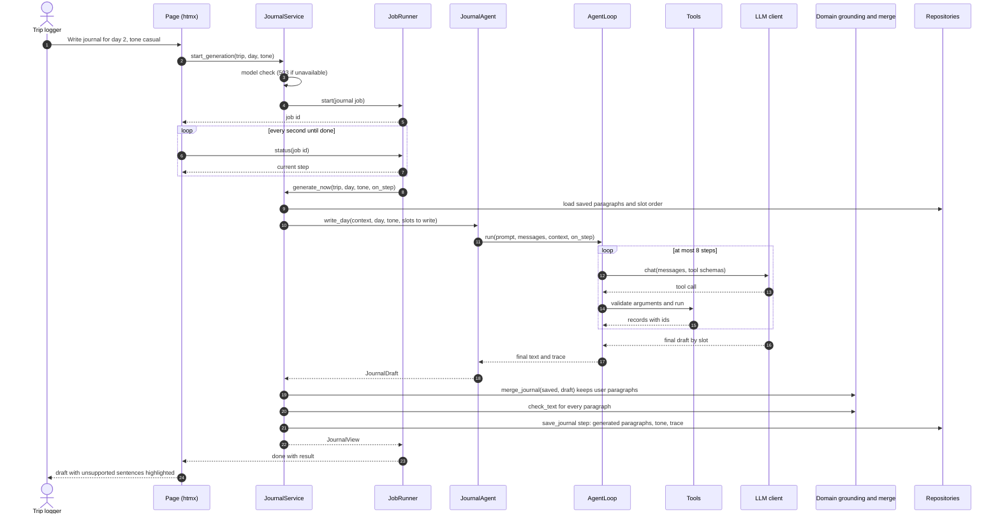
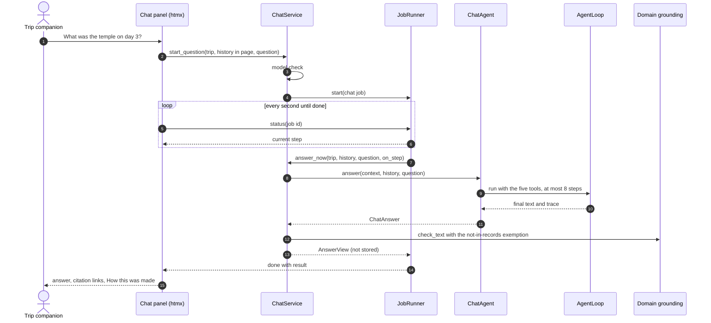

# Services and Orchestration

The `services/` package holds one service per feature plus the job runner (design Q3 A). Page routes and JSON routers are thin: they validate input, call one service method and render the result (design Q4 A). Services coordinate the agent, domain and data components; they never contain SQL or prompts.

## Service Catalogue

| Service | Responsibility | Calls | Stories |
|---|---|---|---|
| ImportService | Validate and store a trip; reject duplicates | Import Schema, Day Derivation, Repositories | US-01, US-03, US-21 |
| TripService | Trip list, active trip, day view, delete trip | Repositories | US-02, US-03, US-04, US-05 |
| OrganizerService | Run the organizer as a job; accept, edit, reject, accept all | JobRunner, NoteOrganizer, Repositories, SettingsService | US-06, US-07, US-08 |
| JournalService | Generate or regenerate, ground, merge, save, edit | JobRunner, JournalAgent, Grounding, Journal Merge, Repositories, SettingsService | US-09 to US-13, US-20 |
| ChatService | Answer a question, ground it, return it without storing | JobRunner, ChatAgent, Grounding, Repositories, SettingsService | US-14, US-15, US-16, US-20 |
| SettingsService | Resolve and save settings; report model status | SettingsRepository, config, LLM Client | US-17, US-18, US-19 |
| JobRunner | One LLM job at a time; progress and results for polling | (runs work given by other services) | US-06, US-09, US-14, US-19 |

## Cross-Cutting Orchestration Rules

1. **Model check before every LLM job.** A service calls `SettingsService.model_status()` first. If Ollama is unreachable or the model is missing, it raises `ModelUnavailableError` with guidance, and no job starts (FR-10.3, US-19).
2. **One job at a time.** `JobRunner.start()` refuses a second LLM job with `ModelBusyError` (design Q6 A). Import, browsing, editing, deleting and settings never use the job runner, so they always work.
3. **Progress by polling.** A job reports each agent step through `on_step`. The page polls `GET /jobs/{job_id}` about once a second with htmx until the state is `done` or `failed` (design Q5 A). No model text is streamed (FR-4.7).
4. **Tool scope.** Each job builds a `ToolContext` for the active trip. Tools cannot read other trips, the file system or the network, except through PlaceLookup (NFR-3.5).
5. **Failure never damages saved data.** A failed or step-limited generation does not change the saved journal (US-20). Database writes happen in one transaction at the end of a successful flow.
6. **Same methods for jobs and evaluation.** Each job wraps a service's `*_now()` coroutine. The evaluation script calls those coroutines directly (design Q13 A).

---

## Flow 1: Import a Trip (US-01, US-03)

```text
Page/API --upload--> ImportService.import_trip(raw)
  1. parse_trip_file(raw)            -> TripFile or ImportValidationError(issues)
  2. TripRepository.get_by_source_id -> exists? -> TripAlreadyExistsError
  3. group_stops_by_day(stops)       -> local dates
  4. transaction: insert trip, stops, notes (+ FTS5), photos; keep source ids
  5. return TripSummary (days with counts)
```

## Flow 2: Delete a Trip (US-03)

```text
Page shows confirmation -> user confirms -> TripService.delete_trip(trip_id)
  transaction: delete trip; foreign keys cascade to stops, notes, photos,
               suggestions, journals, paragraphs and saved traces
  if it was the active trip -> active trip cleared
```

## Flow 3: Organize Notes (US-06, US-07, US-08)

```text
OrganizerService.start(trip_id, day or None)
  model check -> JobRunner.start("organize", work)
  work: for each day in scope:
          on_step("organizing notes for <day>")
          NoteOrganizer.organize_batch(day stops, day notes)   # one structured call per day
          SuggestionRepository.replace_pending(day suggestions)
  result: counts per day + dropped suggestions

Review (no LLM, no job):
  accept / edit_and_accept / reject -> SuggestionRepository.set_status(...)
  accept_all_pending(day)           -> only suggestions still pending on that day
  raw note text is never written
```

## Flow 4: Generate or Regenerate a Journal (US-09, US-10, US-13, US-20)



**Text alternative**
1. The page asks JournalService to start; JournalService checks the model, then starts a job, and the page polls for the current step.
2. In the job, JournalService loads the saved journal. Only slots that are missing or generated are sent to JournalAgent (`slots_to_write`). If no slot is left, the service returns "nothing to regenerate" without calling the model (US-13, scenario 3).
3. JournalAgent runs the shared AgentLoop (at most 8 steps). The tools return records with ids, and the model returns a draft keyed by slot.
4. JournalService merges the draft with the user-owned paragraphs, runs the grounding check on every paragraph, and performs the **save_journal step**, which writes only generated paragraphs, with the tone, the trace and the prompt version.
5. If the loop hits the step limit, the job fails with `AgentStepLimitError` and the trace so far; nothing is saved.

## Flow 5: Edit a Paragraph (US-12)

```text
Page (paragraph edit) -> JournalService.edit_paragraph(trip, day, slot, text)
  mark_user_edit(...) -> owner = "user"
  check_text(text, known ids) -> highlights refreshed
  JournalRepository.save(...)  (autosave, current version only)
```

## Flow 6: Ask a Question (US-14, US-15, US-16)



**Text alternative**
1. The page sends the question with the conversation it holds (the last 10 turns at most). The server stores no chat history (FR-7.2).
2. ChatService checks the model and starts a job; the page polls for the current step.
3. ChatAgent runs the shared AgentLoop with the five tools.
4. ChatService runs the grounding check, treating the exact sentence "That is not in your records." as valid (FR-5.3), and returns the answer, its sentence checks and its trace. The page appends them to the conversation, and they are not saved.

## Flow 7: Place Lookup inside a Tool (US-17)

```text
lookup_place tool -> PlaceLookup.lookup(lat, lon, imported_name)
  setting off          -> imported name (source "import"); no request
  cache hit            -> cached name (source "cache")
  else wait for the 1-request-per-second limit, then httpx GET Nominatim reverse (timeout, User-Agent)
    success            -> cache and return (source "nominatim")
    any failure        -> imported name or none (source "import" / "none"); the agent carries on
```

## Flow 8: Settings (US-17, US-18, US-19)

```text
SettingsService.get(): SQLite settings table > environment variable > built-in default
  TRIP_JOURNAL_MODEL, TRIP_JOURNAL_OLLAMA_URL, TRIP_JOURNAL_PLACE_LOOKUP
SettingsService.update(change): validate, save to SQLite; the next job uses the new values (no restart)
SettingsService.model_status(): LLM client status -> reachable? model installed?
```

## Flow 9: Evaluation Run (US-21 to US-24)

```text
uv run python scripts/evaluate.py
  temporary database -> ImportService.import_trip(sample trips)
  OrganizerService.organize_now per day        -> compare with evaluation labels by source id
  JournalService.generate_now per day          -> grounding rate and timings
  ChatService.answer_now per question          -> answer accuracy and timings
  print the report: metric, value, target, model name, prompt version, machine
```
