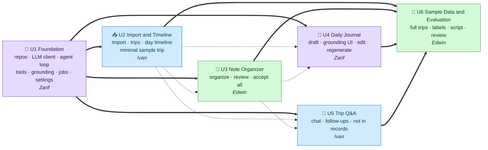
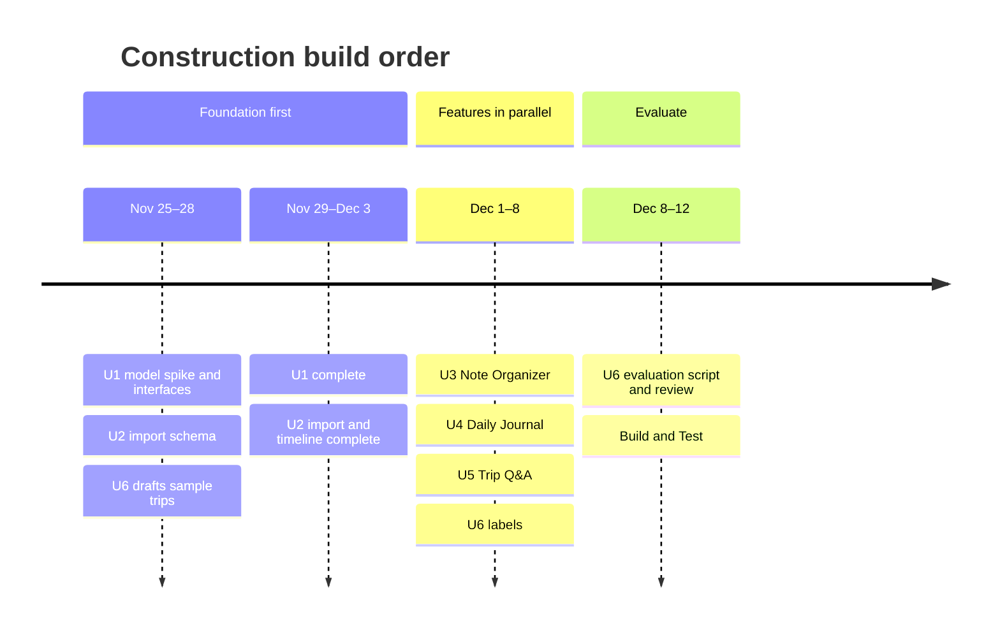

# Unit of Work Dependencies

## Dependency Matrix

Read across: the row unit **depends on** the column unit. `●` = hard dependency (needs the code merged) · `○` = soft dependency (needs only an interface, fixture or file format; work can start in parallel) · blank = none.

| depends on → | U1 Foundation | U2 Import and Timeline | U3 Note Organizer | U4 Daily Journal | U5 Trip Q&A | U6 Sample Data and Evaluation |
|---|---|---|---|---|---|---|
| **U1 Foundation** | | | | | | |
| **U2 Import and Timeline** | ● repositories, schema, app shell | | | | | |
| **U3 Note Organizer** | ● LLM client, JobRunner, repositories | ○ stored notes, timeline stop fragment, minimal trip | | | | |
| **U4 Daily Journal** | ● AgentLoop, tools, grounding, JobRunner | ○ stored trips, minimal trip | ○ organized fields shown in notes if present | | | |
| **U5 Trip Q&A** | ● AgentLoop, tools, grounding, JobRunner | ○ stored trips, minimal trip | ○ organized ratings for "what did I rate highest?" | | | |
| **U6 Sample Data and Evaluation** | ○ settings, temporary database | ● import (sample trips must import) | ● organizer (accuracy metric) | ● journal (grounding metric) | ● Q&A (accuracy metric) | |

**Checks**
- **No cycles.** U1 depends on nothing; U2 only on U1; U3, U4 and U5 on U1 (hard) and U2 (soft); U6 on all the others.
- **U3, U4 and U5 do not depend on each other's code.** The soft links to U3 only change what the tools return (organized fields, when they exist), so U4 and U5 work with or without U3 merged.
- **U1 is the critical path.** Its interfaces (repositories, `LLMClient` with `FakeLLMClient`, `ToolRegistry`, `check_text`, `JobRunner`) are defined and merged first, so the others can build against them (plan Q3 A).

## Dependency Diagram

**Text alternative.** Arrows point from a unit to the units that depend on it. Thick arrows are hard dependencies; dashed arrows are soft.
- U1 Foundation (Zarif) → U2, U3, U4, U5 (hard)
- U2 Import and Timeline (Ivan) → U3, U4, U5 (soft: stored data and the minimal trip); U2 → U6 (hard)
- U3 Note Organizer (Edwin) → U4, U5 (soft: organized fields); U3 → U6 (hard)
- U4 Daily Journal (Zarif) → U6 (hard)
- U5 Trip Q&A (Ivan) → U6 (hard)
- Colors show owners: purple for Zarif, blue for Ivan, green for Edwin.

## Build Order and Integration Points

| Step | Dates (README Construction window) | Work | Integration point (merged to `main`) |
|---|---|---|---|
| 1 | Nov 25 – Nov 28 | **U1** model spike, then U1 interfaces and `FakeLLMClient`. **U2** import schema and `docs/import-format.md` (pure domain, no U1 needed yet). **U6** starts drafting the full sample trips against the documented format | I1: U1 interfaces with fakes; U2 import schema |
| 2 | Nov 29 – Dec 3 | **U1** finished (tools, grounding, JobRunner, settings, PlaceLookup). **U2** import service and timeline pages on U1 repositories. **U3, U4, U5** start against fakes and the U2 minimal trip | I2: U1 complete; U2 complete (minimal trip available to all) |
| 3 | Dec 1 – Dec 8 | **U3, U4, U5** in parallel, each on its own branch. **U6** finishes the full trips and labels | I3: U3, U4 and U5 merged one at a time, each after review |
| 4 | Dec 8 – Dec 12 | **U6** evaluation script and manual review; fixes from the results. Build and Test for the whole app | I4: evaluation report and Build and Test instructions |

**Text alternative**: Nov 25–28: U1 spike and interfaces, U2 import schema, and U6 drafts the sample trips. Nov 29 – Dec 3: U1 and U2 are completed. Dec 1–8: U3, U4 and U5 are built in parallel while U6 writes the labels. Dec 8–12: U6 runs the evaluation and manual review, followed by Build and Test.

## Shared Resources and Contracts

| Shared resource | Owner | Used by | Rule |
|---|---|---|---|
| `data/schema.sql` | U1 (core tables) | U3 (suggestions), U4 (journals and paragraphs) | Each unit adds only its own tables in a marked section |
| `data/repositories.py` | U1 (core) | U3, U4 add sections; all units read | Core method signatures change only through a U1 pull request |
| `ToolRegistry` and the five tools | U1 | U4, U5 | The tool schemas in `component-methods.md` are the contract |
| `check_text` / `find_unsupported_sentences` | U1 | U4, U5 | The same function for journals and chat |
| `JobRunner` and the progress fragment | U1 | U3, U4, U5 | One LLM job at a time across the app |
| Shared UI fragments (banner, trace, citation, highlight) | U1 | U2–U5 | Changed only through a U1 pull request |
| Import format (`docs/import-format.md`) | U2 | U6 sample trips, test fixtures | Fixed in step 1; changed only together with the fixtures |
| `FakeLLMClient` scripts | U1 (class) | U3, U4, U5 (their own scripts) | Agent tests never call a real model |
