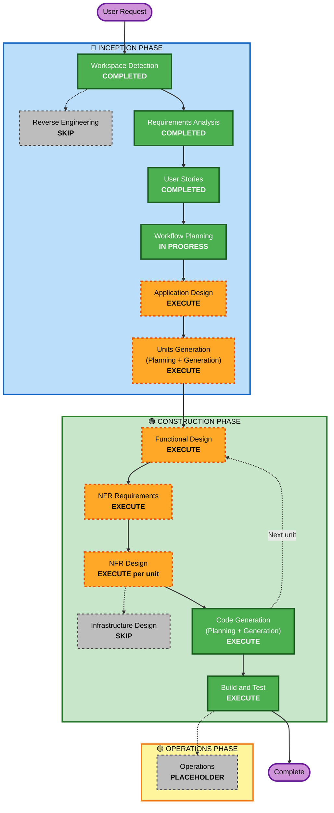

# Execution Plan

**Project**: Trip Journal Agent (greenfield)
**Based on**: `requirements.md` (approved), `stories.md` and `personas.md` (approved), `docs/vision.md`, `docs/technical-environment.md`
**Session scope**: This session runs the Inception phase only and stops after Units Generation is approved. The Construction stages below are planned here and run in the final-project period.

## Detailed Analysis Summary

### Transformation Scope
Not applicable (greenfield: no existing code).

### Change Impact Assessment
- **User-facing changes**: Yes. Everything is new: import, day timeline, note organizer, journal with grounding and editing, Q&A chat, place lookup and settings (24 stories, 9 epics)
- **Structural changes**: Yes. A new layered application (`api/` and `pages/` → `agent/` and `domain/` → `data/`, plus `places/`), per `technical-environment.md`
- **Data model changes**: Yes. A new SQLite schema (trips, stops, notes, photos, note suggestions, journals with user-owned paragraph tracking, place cache) and an FTS5 index, plus the documented JSON import schema
- **API changes**: Yes. A new JSON API under `/api/...` (trips, days, notes, journal, chat, settings) and server-rendered pages
- **NFR impact**: Yes. Speed targets on a laptop (≤ 90 s journal, ≤ 30 s answer), privacy (localhost only, place lookup off by default), handling LLM output as untrusted input, graceful degradation without Ollama, ≥ 80% test coverage, and property-based testing in Partial mode

### Risk Assessment
- **Risk Level**: Medium. Several new components and an LLM whose tool calling may be unreliable on an 8B local model. Everything is local, single-user and has no production data
- **Rollback Complexity**: Easy. Each unit is a separate branch and pull request, and there is no deployed system
- **Testing Complexity**: Moderate. Deterministic parts are tested with pytest and property-based tests. LLM behavior is tested with a fake client, plus an evaluation script on the sample trips

**Main risks carried into design**

| Risk | Where it is handled |
|---|---|
| Unreliable tool calls from the local model | Application Design (agent loop contract), NFR Requirements (choosing the model early), US-20 |
| Losing user-edited text on regenerate | Functional Design of the journal unit (merge rules), property-based invariant tests (PBT-03) |
| Speed on the slowest demo laptop | NFR Requirements (budget per step), US-09 and US-14 timing, US-23 |
| Integration between three owners | Units Generation (clear interfaces and dependency order) |

## Workflow Visualization

### Mermaid Diagram



### Text Alternative

```text
Phase 1: INCEPTION (this session)
- Workspace Detection ........ COMPLETED (greenfield)
- Reverse Engineering ........ SKIPPED (no existing code)
- Requirements Analysis ...... COMPLETED (approved)
- User Stories ............... COMPLETED (approved)
- Workflow Planning .......... IN PROGRESS (this document)
- Application Design ......... EXECUTE
- Units Generation ........... EXECUTE  -> session stops after approval

Phase 2: CONSTRUCTION (final-project period, per unit)
- Functional Design .......... EXECUTE (every unit)
- NFR Requirements ........... EXECUTE (every unit)
- NFR Design ................. EXECUTE only for units with NFR patterns
- Infrastructure Design ...... SKIP (local only, no cloud)
- Code Generation ............ EXECUTE (always)
- Build and Test ............. EXECUTE (always, after all units)

Phase 3: OPERATIONS
- Operations ................. PLACEHOLDER
```

## Phases to Execute

### 🔵 INCEPTION PHASE
- [x] Workspace Detection (COMPLETED)
- [x] Reverse Engineering (SKIPPED: greenfield)
- [x] Requirements Analysis (COMPLETED)
- [x] User Stories (COMPLETED)
- [x] Execution Plan (IN PROGRESS)
- [ ] Application Design - EXECUTE
  - **Rationale**: Every component is new: import validation, repositories, tool registry, agent loop, grounding check, journal merge, place lookup with cache, API routers and pages. Their responsibilities, method signatures and dependencies must be defined before three people build them in parallel. This stage also settles the items carried forward from requirements: the exact JSON schema shape and how settings are stored.
- [ ] Units Generation - EXECUTE
  - **Rationale**: The system spans several modules (`data/`, `domain/`, `agent/`, `places/`, `api/`, `pages/`) and three team members, each of whom will own units in Construction (README collaboration plan). The units need a dependency order and a mapping from units to stories (`unit-of-work-story-map.md`).

### 🟢 CONSTRUCTION PHASE (planned; runs in the final-project period)
- [ ] Functional Design - EXECUTE (every unit)
  - **Rationale**: There are new data models (SQLite schema, import schema, paragraph ownership) and non-trivial business rules (deriving days from offsets, the journal merge that keeps user-owned paragraphs, the grounding rules including the "not in your records" exception, accepting suggestions in bulk). Property-based testing rule PBT-01 requires a "Testable Properties" section here. In Partial mode PBT-01 is advisory, but it feeds the blocking rules PBT-02 and PBT-03.
- [ ] NFR Requirements - EXECUTE (every unit)
  - **Rationale**: The speed targets, privacy and untrusted-LLM-output rules need to be made concrete per unit. The property-based testing framework must be selected and documented (PBT-09, blocking in Partial mode). The local model choice (`qwen3:8b` or an alternative) is confirmed with an early spike.
- [ ] NFR Design - EXECUTE per unit (only where NFR patterns apply)
  - **Rationale**: Patterns are needed in the agent unit (step cap, argument validation, timeouts, degrading without Ollama) and the place-lookup unit (cache, 1 request per second, offline fallback). Units with no NFR patterns of their own, such as pages that only render data, skip this stage. The skip is recorded per unit.
- [ ] Infrastructure Design - SKIP
  - **Rationale**: There is no cloud provider and nothing is deployed. The app runs on each laptop with `uv run uvicorn ...` and a local Ollama (`technical-environment.md`). There are no infrastructure resources to map.
- [ ] Code Generation - EXECUTE (ALWAYS)
  - **Rationale**: Implementation planning and code generation are needed for every unit.
- [ ] Build and Test - EXECUTE (ALWAYS)
  - **Rationale**: Build, unit, agent (fake LLM), API and property-based tests, plus the evaluation-script run on the sample trips.

### 🟡 OPERATIONS PHASE
- [ ] Operations - PLACEHOLDER
  - **Rationale**: Future deployment and monitoring workflows; not required for this project.

## Package Change Sequence
Not applicable (greenfield). The build order of units is defined in Units Generation (`unit-of-work-dependency.md`).

## Estimated Timeline

| Period | Stages | Dates (from README) |
|---|---|---|
| Inception (this session) | Application Design, Units Generation | Nov 23–24 (milestone due Nov 24) |
| Construction | Per-unit Functional Design → NFR Requirements → NFR Design (where needed) → Code Generation, one unit per owner | Nov 25 – Dec 10 |
| Build and Test plus evaluation | Build and Test; evaluation-script runs on the sample trips | Dec 8–12 |
| Demo preparation | Demo video and presentation | Dec 11–15 (final project due Dec 16) |

- **Total stages**: 13 (Inception 7, Construction 6). **Executed**: 11 in total: 6 Inception stages (all except Reverse Engineering) and 5 Construction stages (all except Infrastructure Design), with NFR Design run per unit. **Skipped**: Reverse Engineering and Infrastructure Design. Operations is a placeholder.

## Success Criteria
- **Primary goal**: A local web app that imports a trip, organizes notes, writes an editable cited daily journal and answers questions about the trip, meeting the vision's success metrics on the synthetic sample trips
- **Key deliverables**:
  - Inception (this session): `application-design/` artifacts, `unit-of-work.md`, `unit-of-work-dependency.md`, `unit-of-work-story-map.md`
  - Construction (final project): working code at the repository root, tests, sample trips, evaluation set and script, build-and-test instructions
- **Quality gates**:
  - Every Inception stage is approved by the team and recorded in `audit.md`
  - Every story in `stories.md` maps to exactly one primary unit (`unit-of-work-story-map.md`)
  - ruff and mypy pass; line coverage of domain functions and tools is at least 80%
  - Blocking property-based testing rules (PBT-02, PBT-03, PBT-07, PBT-08, PBT-09) are compliant at their stages
  - Evaluation targets: grounding ≥ 95% with 0 invented facts, organizer ≥ 85%, Q&A ≥ 80%, journal ≤ 90 s, answer ≤ 30 s, 100% of user edits kept
