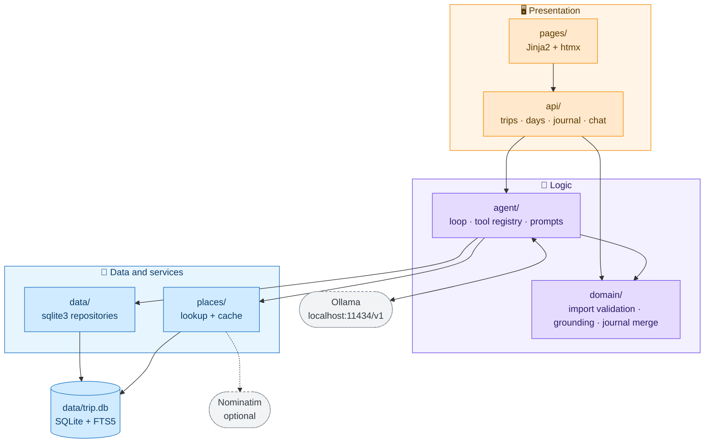

# Technical Environment: Trip Journal Agent

## Language and Package Manager

- **Python 3.12+**
- **uv** for all package management and running commands (`uv sync`, `uv run`); no pip, poetry or conda
- `pyproject.toml` holds all project and tool configuration; `uv.lock` is committed

## Frameworks and Libraries

| Purpose | Choice | Notes |
|---|---|---|
| Web framework | **FastAPI** with **Pydantic v2** | JSON API under `/api/...` plus server-rendered pages |
| Pages | **Jinja2** templates + **htmx** (one static script file) | No JavaScript build step |
| Storage | **SQLite** through the standard-library `sqlite3` module | One file `data/trip.db`; **FTS5** full-text index for note search |
| LLM client | **openai** Python SDK pointed at Ollama's OpenAI-compatible endpoint (`http://localhost:11434/v1`) | Chat completions with `tools` (function calling) |
| HTTP client (place lookup) | **httpx** | Async, with timeouts |
| Server | **uvicorn** | `uv run uvicorn trip_journal.main:app --reload` |

## LLM and Agent

- **Provider:** Ollama, running locally on each teammate's laptop
- **Planned model:** `qwen3:8b` (supports tool calling); fallback to a smaller or larger tool-capable model from the Ollama library if laptops are too slow or tool calls are unreliable. Model name is a setting, not hard-coded.
- **Agent loop:** our own small loop (no agent framework): send messages + tool schemas → if the model returns tool calls, validate the arguments with Pydantic, run the tool, append the result, repeat; stop at a final answer or after **8 steps** max
- **Tools (read-only over the user's data, except the explicit save step):** `list_day_stops(day)`, `get_stop_notes(stop_id)`, `find_photos(start, end)`, `search_notes(query)`, `lookup_place(lat, lon)`
- **Grounding:** generated text must cite record ids (`[stop:12]`, `[note:40]`); a checker rejects or flags sentences whose citations are missing or do not exist
- **Prompts** live in versioned files under `trip_journal/agent/prompts/`, not inline strings

## Cloud Provider and Deployment Model

- **No cloud provider. The product runs locally only**, on each teammate's laptop, for the demo.
- How it runs: a local FastAPI web app (`uv run uvicorn ...`) opened at `http://localhost:8000`, calling a model served by **Ollama** on the same laptop.
- The only outbound network call is the optional place lookup (OpenStreetMap Nominatim reverse geocoding), cached in SQLite; the app works without it.
- No hosted LLM is used by default, so trip data never leaves the laptop.

## Architecture and Project Structure

```text
trip_journal/
  main.py            FastAPI app, routers, startup
  api/               routers: trips, days, journal, chat
  pages/             page routes + Jinja2 templates
  domain/            pure functions: import validation, grounding check, journal merge
  data/              sqlite3 connection, schema.sql, repositories
  agent/             agent loop, tool registry, tool functions, prompts/
  places/            place lookup with cache
tests/
sample_data/         synthetic trips only (no real personal data)
```



- Layers call downward only: `api/pages → agent/domain → data`. Tools call repositories, never raw SQL in the agent loop.
- Times are stored as UTC ISO-8601 strings plus the local UTC offset; coordinates are WGS-84 decimal degrees.

## Testing

| Type | Tool | Target |
|---|---|---|
| Unit tests | **pytest** | Domain functions and tools: ≥ 80% line coverage (pytest-cov) |
| Agent tests | pytest with a **fake LLM client** that returns scripted tool calls | Agent loop, step limit, argument validation, error handling — no real model needed |
| API tests | FastAPI `TestClient` | Each endpoint: success and error cases |
| LLM evaluation | Small script over the sample trips | Grounding rate, note-classification accuracy, Q&A accuracy (targets in the vision document) |
| Lint / types | **ruff** (lint + format), **mypy** | Must pass before merging |

## Do NOT Use

| Prohibited | Reason | Use Instead |
|---|---|---|
| LangChain, LlamaIndex, CrewAI, AutoGen | Heavy abstractions hide the agent loop we must design and explain; frequent breaking changes | Own agent loop with the `openai` SDK |
| Vector databases (Chroma, Pinecone, FAISS) | One trip is small; keyword + structured queries are enough for the MVP | SQLite FTS5 and SQL queries through tools |
| Hosted LLM APIs by default (OpenAI, Anthropic, Gemini) | Sends personal location data off the laptop; costs money | Ollama local model (a hosted model only behind an explicit setting, with sample data) |
| `requests` | Blocks the async event loop | `httpx` |
| SQLAlchemy, Django ORM | More than a single-file SQLite app needs | Standard-library `sqlite3` with a small repository layer |
| Flask, Django | Project uses FastAPI | FastAPI |
| React, Vue, Node build tooling | Adds a JS build pipeline for a few pages | Jinja2 + htmx |
| Streamlit | Hard to test and to separate UI from API | FastAPI + Jinja2 |
| `eval()`, `exec()`, `pickle` on imported files | Arbitrary code execution from untrusted input | Pydantic validation of JSON |
| pip, poetry, pipenv, conda | Project uses uv | uv |
| black, flake8, isort | Replaced by ruff | ruff |

## Security Basics

- **Auth:** none — single user on `localhost`; the server binds to `127.0.0.1` only.
- **Input validation:** every import file and request body is a Pydantic model; import files are limited to 20 MB; unknown fields are rejected.
- **LLM output is untrusted:** tool arguments from the model are validated with Pydantic before running; tools are read-only except `save_journal`, which only writes generated paragraphs; model text is HTML-escaped by Jinja2 autoescape before display.
- **Prompt injection:** note text is passed to the model as data inside clearly delimited tool results, never as instructions; tools cannot reach the file system or the network except the place lookup.
- **Secrets:** none needed with Ollama. If a hosted provider is ever enabled, its key lives in a git-ignored `.env` file read through environment variables, never committed or logged.
- **Privacy:** only synthetic sample data is committed; `data/` (the local database) is git-ignored.
- **External service:** place lookup follows the Nominatim usage policy (max 1 request per second, identifying User-Agent, results cached).

## Example Code Patterns

A typical endpoint:

```python
from fastapi import APIRouter, Depends, HTTPException
from pydantic import BaseModel, Field

from trip_journal.agent.journal import JournalAgent, get_journal_agent
from trip_journal.data.repositories import DayRepository, get_day_repository

router = APIRouter(prefix="/api/trips/{trip_id}/days")


class JournalRequest(BaseModel):
    tone: str = Field(default="casual", pattern="^(casual|concise|detailed)$")


class JournalResponse(BaseModel):
    paragraphs: list[str]
    unsupported_sentences: list[str]
    tool_calls: list[str]


@router.post("/{local_date}/journal", response_model=JournalResponse)
async def generate_journal(
    trip_id: int,
    local_date: str,
    request: JournalRequest,
    days: DayRepository = Depends(get_day_repository),
    agent: JournalAgent = Depends(get_journal_agent),
) -> JournalResponse:
    day = days.get(trip_id, local_date)
    if day is None:
        raise HTTPException(status_code=404, detail=f"No day {local_date} in trip {trip_id}")
    result = await agent.write_day(day, tone=request.tone)
    return JournalResponse(
        paragraphs=result.paragraphs,
        unsupported_sentences=result.unsupported_sentences,
        tool_calls=[call.name for call in result.tool_calls],
    )
```

A typical function (a grounding check in `domain/`):

```python
import re

CITATION = re.compile(r"\[(stop|note|photo):(\d+)\]")


def find_unsupported_sentences(text: str, known_ids: set[tuple[str, int]]) -> list[str]:
    """Return sentences that cite nothing, or cite a record that does not exist."""
    unsupported: list[str] = []
    for sentence in re.split(r"(?<=[.!?])\s+", text.strip()):
        if not sentence:
            continue
        cited = {(kind, int(num)) for kind, num in CITATION.findall(sentence)}
        if not cited or not cited <= known_ids:
            unsupported.append(sentence)
    return unsupported
```

A typical test:

```python
from trip_journal.domain.grounding import find_unsupported_sentences

KNOWN = {("stop", 1), ("note", 7)}


def test_sentence_with_valid_citation_is_supported() -> None:
    text = "We had noodles near the river [stop:1][note:7]."
    assert find_unsupported_sentences(text, KNOWN) == []


def test_sentence_without_citation_is_flagged() -> None:
    text = "We had noodles [stop:1]. Then we saw a parade."
    assert find_unsupported_sentences(text, KNOWN) == ["Then we saw a parade."]


def test_citation_to_missing_record_is_flagged() -> None:
    text = "The museum was closed [stop:99]."
    assert find_unsupported_sentences(text, KNOWN) == ["The museum was closed [stop:99]."]
```
