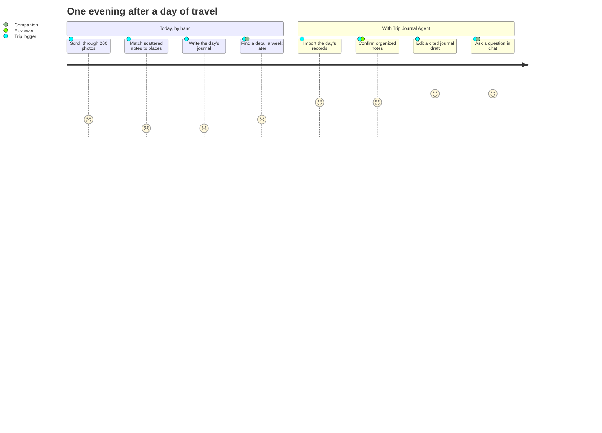
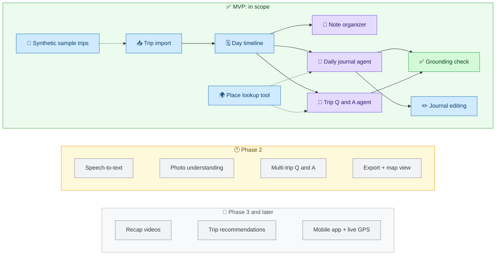

# Vision: Trip Journal Agent

## Executive Summary

Trip Journal Agent is a local web app that turns the raw records of a trip — stops, timestamps, photo metadata and quick notes — into a readable daily journal and a searchable memory of the trip. An LLM agent reads the user's own trip data through a small set of tools, organizes messy notes, writes a journal in which every statement is traceable to a record, and answers questions such as "where did we eat the best noodles?". It is for travelers who already log their trips (with a tracking app, a camera and a notes app) but never have the time to turn the records into something they will read again. Everything runs on the user's laptop so personal location data stays private.

## Problem Statement

A day of travel produces a lot of data: a route, 5–15 stops, many photos, and short notes written in a hurry ("broth great, too salty, 4/5", "40 min queue — skip"). The structured part (times, places, photos) is easy to store, but it is not a story, and the informative part (what the traveler felt, liked and learned) is buried in fragments that use informal, mixed-language and context-dependent wording. Writing a journal by hand takes an evening per day; finding one detail later means scrolling through hundreds of items.

Templates and rules can list stops in order, but they cannot tell which notes belong to the same meal, which moment mattered, or what "this place" refers to, and they cannot answer a loosely phrased question. Generic chatbots can write prose but invent details when they are not grounded in the actual records. The product must combine both: language understanding from an LLM, and facts only from the user's data.

**The trip logger's evening, today vs. with Trip Journal Agent** (score = how the step feels, 1 = painful, 5 = great):

## Target Users

| User type | Description | What they need |
|---|---|---|
| Trip logger (primary) | Takes multi-day trips, records stops and notes with a phone app, takes many photos; comfortable importing a file | A journal draft per day within a minute of asking, that they only need to lightly edit; quick answers about past days |
| Food and place reviewer | Rates and comments on restaurants and sights during trips | Notes turned into clean per-place reviews (dish, rating, tip) attached to the right stop |
| Trip companion / family member | Travelled with the logger, did not take notes | Can ask questions in plain language ("what was the name of the temple on day 3?") without learning the data format |

## Success Metrics

| Metric | Target (measured on the sample trips) |
|---|---|
| Journal grounding | ≥ 95% of journal sentences cite at least one stop or note; 0 invented stop names, times or ratings in the demo trips |
| Note organization accuracy | ≥ 85% of notes get the correct category and stop on a hand-labelled set of ≥ 40 notes |
| Q&A accuracy | ≥ 80% correct on a written list of ≥ 20 questions about the sample trip; questions with no answer in the data get "not in your records", not a guess |
| Speed on a laptop | A day journal draft in ≤ 90 s and a Q&A answer in ≤ 30 s with the local model |
| User edits respected | 100% of user-edited journal text survives a regenerate |

## Full Scope Vision

| Feature area | At maturity |
|---|---|
| Capture | Direct sync from a phone tracking app; speech-to-text for voice notes |
| Understanding | Photo understanding with a vision model (what is in each photo); duplicate and similar-photo grouping |
| Writing | Daily and whole-trip journals in several tones; captions and narration scripts for recap videos |
| Retrieval | Q&A across many trips ("which city had the best coffee?"); map view of answers |
| Planning | Suggestions for the next trip based on what the user rated highly |
| Sharing | Export a journal to HTML/PDF; share with companions |

## MVP Scope — Features IN

| Feature | Description | Rationale |
|---|---|---|
| Trip import | Import one trip from a JSON file (trip, days, stops with times and coordinates, notes, photo metadata). Validate and show clear errors | The agent needs structured data; a file import avoids building a mobile app |
| Day timeline | Page per day listing stops in time order with their notes and photo count | The user must see the facts the agent works from |
| Note organizer (LLM) | For each raw note: category (food / scene / logistics / feedback / other), extracted fields (dish, rating, tip), and suggested stop. User accepts or corrects each suggestion | Turns fragments into structured, reusable facts; human confirmation keeps data correct |
| Daily journal agent (LLM + tools) | Agent plans the day, calls tools (day stops, stop notes, photos in a time window, note search, place lookup), and writes a draft journal with a citation per sentence | Core value: a readable story from raw records |
| Grounding check | Checks every journal sentence and Q&A answer against cited records; flags unsupported sentences in the UI | Prevents invented facts, the main risk of LLM writing |
| Journal editing | User edits the draft; regenerate keeps user-edited paragraphs and only rewrites generated ones | User text must never be lost |
| Trip Q&A agent (LLM + tools) | Chat panel; agent answers by calling the same tools; shows which tools it called and which records it used; says when the data has no answer | Fast retrieval in plain language |
| Place lookup tool | Reverse geocode a coordinate to a place name, cached locally; offline fallback uses names already in the import | Gives the agent human place names; caching respects rate limits |
| Sample trip data | Two synthetic trips (3–4 days each) with no real personal data, used for demo and tests | Safe demo; repeatable evaluation |

## MVP Scope — Features OUT

| Feature | Reason | Target phase |
|---|---|---|
| Mobile app, live GPS tracking | Large separate effort; not where the LLM adds value | Later |
| Stop detection from raw GPS | Input already contains stops | Later |
| Speech-to-text for voice notes | Extra model and audio handling; notes arrive as text | Phase 2 |
| Photo content understanding (vision model) | Heavy on a laptop; MVP uses photo time and location only | Phase 2 |
| Recap video and narration scripts | Video pipeline is out of the course scope | Phase 3 |
| Next-trip recommendations | Needs external place data and a different evaluation | Phase 3 |
| Multi-trip Q&A | MVP answers within one imported trip | Phase 2 |
| Accounts, multi-user, cloud hosting | Runs locally for one user | Not planned |
| HTML/PDF export and sharing | Nice to have; not core to the LLM value | Phase 2 |
| Map view | Nice to have; timeline is enough for the MVP | Phase 2 |

**Scope at a glance:**

## Risks and Open Questions

### Risks

| Risk | Impact | Mitigation |
|---|---|---|
| Local 8B model calls tools unreliably | Agent loops or skips tools | Cap steps per request, validate tool arguments with schemas, test a second model early |
| LLM invents details | Wrong journal facts | Citation per sentence + grounding check; flag unsupported text |
| Slow generation on laptops without a GPU | Demo feels slow | Stream output; keep prompts small by fetching only needed records through tools |
| Public geocoding service rate limits or is unreachable | Missing place names | Local cache, 1 request per second limit, offline fallback to imported names |

### Open Questions

- Which local model gives the most reliable tool calling on our laptops (`qwen3:8b` vs. alternatives), and do all teammates' laptops have enough memory?
- Should the journal be one paragraph per stop, or a free-form narrative of the day with citations inline?
- How should mixed-language notes (e.g., Chinese and English in one note) be handled — keep the original language, or write the journal in one language?
- Should the note organizer run automatically on import, or only when the user asks?
- What exact JSON import format should we support, and should we also accept GPX for the route?
- How do we measure grounding automatically — exact record citation only, or also an LLM-as-judge check?
